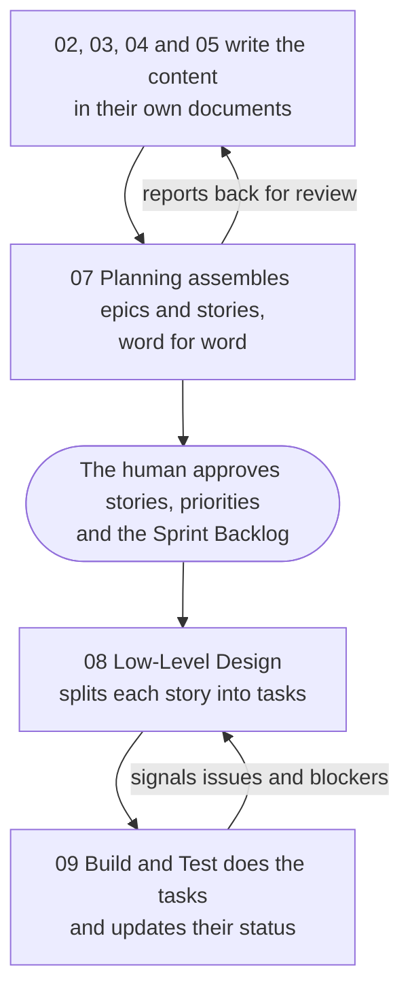

# Who owns the plan: epics, stories and tasks

A project's plan is made of epics, stories and tasks. Every ASDG role has one part in it, so that each piece of the plan has one owner and nobody rewrites another role's work.
This page gives the shared vocabulary and that division. It applies wherever the plan is kept: planning documents, a structured plan file or GitHub Issues.

*Content flows down from its owners; review and problems flow back up to whoever owns the words.*

## Vocabulary

| Term | Meaning |
| --- | --- |
| Epic | A group of stories with a common theme and purpose |
| Story | One thing a user needs, with its acceptance criteria |
| Task | A piece of work needed to finish a story; a child of that story |
| Product Backlog | Every story that could be done, in priority order |
| Sprint | A fixed period of work with one goal |
| Sprint Backlog | The stories chosen for one sprint, with their tasks and the sprint goal |

Use these agile and Scrum terms even where a tool names things differently.

## Each role's part

| Role | Like, in a delivery team | Owns | Does not do |
| --- | --- | --- | --- |
| 02 Purpose, 03 System Model and Use Cases, 04 Benchmarks and Eval Strategy, 05 High-Level Design and Architecture | Business person, business analyst, specialists | The content of epics and stories: the why, the scenarios, the acceptance, the constraints | Project bookkeeping |
| 07 Planning | Project manager, Scrum master | Assembling that content into epics and stories, proposing the Product Backlog order and the Sprint Backlog, reporting the result back, and making the collaboration happen | Writing or rewording content |
| 08 Low-Level Design | Technical lead | Splitting a story into tasks, the content of each task, and answering issues raised on it | Implementing the task |
| 09 Build and Test | Developer | Doing tasks, updating their status, commenting, and signalling issues and blockers | Changing what a task is |
| The human | Product owner | Approving stories and priorities; starting and closing sprints | |
| Every other role | | Its own documents, which may inform the plan | Editing an epic, story or task; it proposes the change to the owner |

## Rules

- **Planning quotes; it does not author.** It copies each piece word for word and links it to the owner's document. A change to the words is made by the owner in that document, then assembled again.
- **Review goes back to the owner.** Planning reports the assembled epics, stories and tasks to their owners, who review them and propose changes.
- **Problems go up one level.** 09 signals an issue or blocker on a task and 08 answers it. Only 08 changes what a task is.
- **The plan grants no permission.** A story in a Sprint Backlog does not allow implementation; the [sprint gate](sprint-gate.md) and the human's decisions still do.
- **These responsibilities bind ASDG roles.** A tool may let anyone edit any field; follow this page regardless, under [documentation authority](documentation-authority.md).
