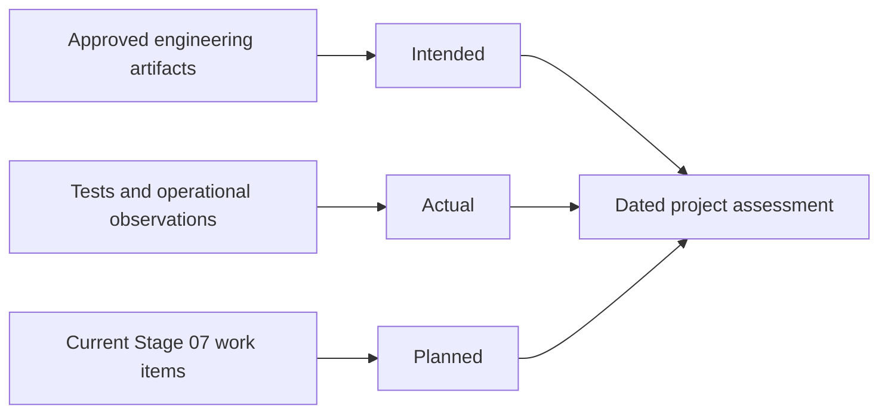

# Organizing lifecycle documentation

Each specialist maintains the engineering artifacts for its domain under its existing client stage directory in `docs/asdg/`. Use the stage README to navigate the material. Name documents for the work they describe. Numbering may communicate reading order. Supporting images, sources and named [decision packages](../../skills/asdg-decision/record-format.md) stay with their owner.

| Domain | Authoritative record | Example |
| --- | --- | --- |
| Purpose | The system’s purpose, beneficiaries and boundaries | `02-purpose/01-purpose.md` |
| Use Cases | System model and illustrated scenarios | A use case may describe behavior before implementation |
| Architecture | Selected design, decisions and diagrams | A decision links to its reviewed design and alternatives |
| POC and Build and Test | Experiments, revisions and test results | A dated run records its environment and limitations |
| Planning | Integrated priorities, progress, gaps, dependencies and proposed or selected work | A sprint work item links to the responsible specialist’s artifact |

Keep each Markdown unit within 50 nonblank lines. Split a document when its topics merit separate treatment. A domain can have a single artifact. Skip empty directories, duplicate summaries and documents created solely to fill an assessment category.

## Reporting and closeout

A [project assessment](stage-perspectives.md) reads the approved engineering artifacts, implementation or operational evidence, and current Stage 07 planning records. Cite the sources and mark missing evidence unknown. At closeout, retain the actual test or operating evidence with its owner and update the integrated work item with the result and any remaining gap.

## Existing clients

Initialization preserves existing documents. Leave historical paths, hashes, decisions and review events intact. A client may elect to migrate a living artifact as a separate, owner-scoped change. Update its links and registration together and reassess any changed review bundle before requesting fresh acceptance. The [ownership rules](documentation-authority.md) and human sprint and release gates still apply.
