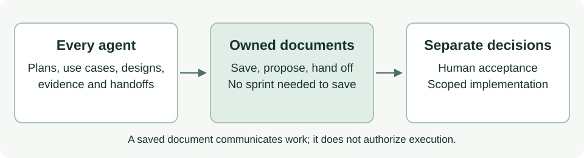

# Pre-write checks and client limits

Use [role ownership](documentation-authority.md) and its [central exceptions](write-exceptions.md) in every writing workflow.
These controls reduce accidental cross-role edits; they do not restrict the repository owner or authenticate agent claims.



## Four authority classes

| Class | May write | Authorized by |
| --- | --- | --- |
| Governance and the twelve specialists | Their owned `docs/asdg/` stage and the listed [exceptions](write-exceptions.md) | Role selection |
| Build and Test | Application code, tests and technical documentation in scope | An active human-started sprint and per-target checks |
| ASDG Admin | Any methodology file the bounded task needs, deletions included | Explicit Admin selection and a bounded human maintenance task, declared as exact `targets` |
| Human owner | Everything, plus approval, commit, push, release, publication, deployment and hook trust | Repository ownership |

Admin scope is the verified standalone source, except Git metadata, or in a client the `asdg/` copy, the root `AGENTS.md` bootstrap and Admin's Stage 07 `02.*` records.
Admin never writes application files, other `.asdg/` state, symlinked or multi-link targets or nested repositories. Client adapters are regenerated from `asdg/templates/` through the explicit update engine.

## Shared preflight in Codex and Claude

Before creating, modifying, moving or deleting a file, recover the acting role from this conversation's loaded selection/assignment receipt.
If uncertain, stop writes and recover it under the session policy; never infer role from a chat title, path or another conversation.
Run the local read-only checker for every target, including both move ends, using the verified role:

```sh
python3 asdg/scripts/cli.py check-write --context '{"role_id":"ASDG-05"}' --path docs/asdg/05-high-level-design-and-architecture/03-options.md
```

Exit 0 permits the path under the declaration; exit 1 blocks it. Save out-of-ownership proposals in the role's directory or return a pending handoff instead.
For a named exception add `workflow` and exact authorized `targets` to the JSON context; OpenSpec additionally needs `openspec_store`, resolved from the installed workflow.
Workflow values are `openspec`, `admin`, `shared-record`, `review-receipt`, `approve`, `purpose-review`, `sprint-start` and `sprint-close`.
`targets` are exact files, never wildcard/directory grants. `review-receipt` is limited to the established append-only project ledger.
A declaration is evidence supplied by the caller, not proof of human approval; follow the named workflow's content, scope and review contract.
The checker separates ownership from sprint permission: only ASDG-09 application targets proceed to existing sprint checks. Ordinary owned documentation never needs sprint/lifecycle state.
Non-documentary runtime files remain implementation even within an owned stage; do not label executable HTML/CSS/JSON evidence to escape the gate.

## Existing Codex pre-tool harness

The existing trusted Codex guard checks every patch source/destination. It denies unsupported tools and arbitrary shell writes.
A reviewed launcher may supply `ASDG_WRITE_CONTEXT` as JSON containing the same context plus `session_id` matching the actual hook payload's session ID.
The guard ignores role claims in tool input, native names and titles. Missing, mismatched or unknown role context denies writes; read-only diagnosis remains available.
Only an external, explicitly configured session-aware launcher should set this environment; clear/replace context on role, task or workflow changes. Never use a shared ACTIVE_ROLE file or global role environment.
No such launcher or native role-retention bridge is installed here. A chat Focus selection alone cannot update a running process environment.
Without that bridge, the trusted guard conservatively blocks patches even when conversation instructions allow them; report the limitation rather than bypassing it.
The native guard's patch boundary is deterministic given the supplied context. Workflow content semantics (append-only receipts, exact approvals, OpenSpec validation, sprint transitions) remain in their owning procedures/utilities.
Direct utility execution in a human terminal retains its prior contract; the patch guard does not open arbitrary shell execution for approved workflows.

## Claude and evidence limits

Claude receives the same canonical ownership instructions and read-only checker through existing adapters. No Claude hook is installed or claimed.
Calling preflight and obeying its result is instructional in both clients; only an actually invoked/trusted hook intercepts tool execution.
Tests with synthetic session payloads prove checker/guard decisions, not native discovery, role recovery, hook trust or actual platform invocation.
Do not change hook trust as part of ownership maintenance. Unknown identity must never silently fall back to unrestricted documentation writes.
The checker cannot verify that a human authorized a declared Admin task; only a session-bound launcher context is outside the agent's control.
Without one, Admin authority rests on explicit selection, the recorded human request and the human's review of the unstaged diff, plus the platform's own permissions such as delete prompts.
