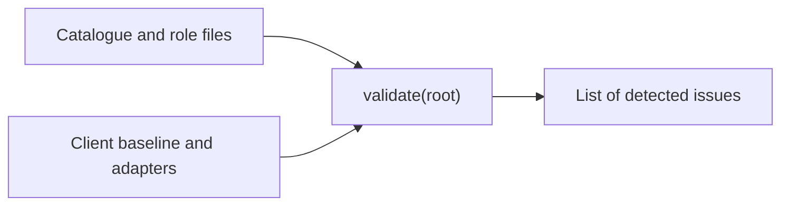

# Checking the legacy agent packages

[Source](validate_agents.py) · [Regression tests](../tests/test_agent_packages.md)

This validator reads an enclosing client with an embedded `asdg/` and its historical baseline and adapter files. The standalone source runs [the portable check](../../scripts/check.py).

`validate(root)` checks identities, governed files, links, review markers and Markdown size. Lifecycle packages require their contracts, tests and skills. Governance also has implementation and documentation directories. `inside(root, value)` resolves bounded references. `skill_fields(front)` parses the supported flat metadata and raises on malformed entries. `main(root)` reports issues and returns an exit status. These functions read files without modifying the client.
