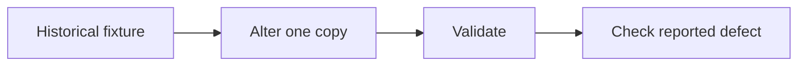

# Legacy package validation tests

[Source](test_agent_packages.py) · [Validator contract](../src/validate_agents.md)

`AgentPackageTests` copies the historical enclosing repository layout to a temporary directory. Cases alter copies of the catalogue, adapters, role files, stage contracts and baseline. They exercise native identity, required files, skill syntax, bounded links and the Markdown line limit.

The missing-directory case removes the Purpose types directory. The length case extends the stage README. On a standalone source checkout this older suite can fail during fixture setup when it looks for enclosing client files. The portable suite exercises the supported standalone distribution.
