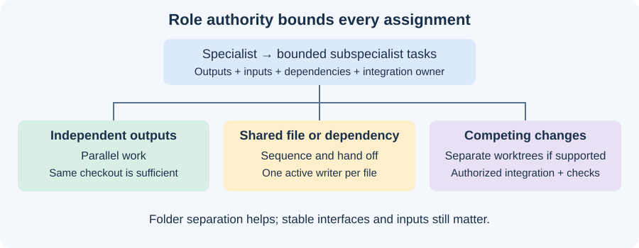

# Independent work within one team

**Read broadly; write within role authority and a bounded assignment. Run independent assignments concurrently. Give each shared file one active writer. Sequence dependencies or integrate isolated alternatives through an authorized owner.** These collaboration rules apply to Sessions, Subagents, and Teammates alike; they do not establish runtime enforcement.

## Authority and assignments

Role ownership is the authority ceiling. A goal narrows each member's output files, inputs, dependencies, tools, completion criteria, and integration owner. Effective permission intersects role, user task authorization, runtime restrictions, and sprint scope where applicable; v1 native teams do not implement application code.

Specialist stage folders provide natural boundaries. A subspecialist inherits a narrower scope from its parent responsibility but is launched by the same lead; there is no child team or recursive spawning in v1. The parent must not edit an output while its assigned member is working on it.

## Choose the coordination pattern

| Work | Rule |
| --- | --- |
| Independent investigation or review | Parallel read-only work; return findings through messages. |
| Independent stage documents | Parallel only after document-write controls pass; assign separate outputs. |
| Two subspecialists in one stage | Assign distinct files/subfolders and one owner of the synthesis/index. |
| Shared file | Serialize; explicit handoff before the next writer. |
| Different files with a changing prerequisite | Agree an input revision, order the tasks, or recheck changed inputs. |
| Alternative changes to the same files | Sequence in v1; isolated worktrees remain a later capability to validate. |
| Review receipts, lifecycle, or generated definitions | Existing authorized writer/workflow, serialized updates. |

For example, Architecture may assign security and data findings to separate outputs under its owned stage while retaining the synthesis. Planning can work from an agreed architecture revision, but must recheck if that revision changes. Separate folders alone do not prove semantic independence.

Use messages for transient questions, challenges, and findings. Save durable conclusions and handoffs in the assigned documentation. Do not turn every exchange into a file or require every assignment to launch another worker. A lead integrates results without inheriting another specialist's write authority.

## Minimal v1 coordination

Use one explicit assignment map within the active run, with member IDs, paths, dependencies, and integration owner. The lead checks overlapping files, parent directories, moves, and generated side effects before dispatch. Reserve no entire stage unnecessarily. Updates to shared files are scheduled by the authorized owner.

Defer general path-reservation/lease infrastructure until after real single-team trials. The map is advisory until runtime controls are demonstrated. Native task claiming is not filesystem locking; do not describe either as a security boundary.

A project-wide run claim prevents two managed ASDG team starts on the same local repository. It does not stop ordinary Focus sessions, editors, or unrelated processes. Detect unexpected changes, pause affected writes, and reconcile; never promise complete conflict freedom.

## Writing and completion gates

First trials are read-only with verified restricted tool profiles. Before document-writing trials, test per-member identity and scoped tool/path controls, including indirect shell or MCP mutations. This scoped enforcement claim covers workers only; the lead remains instruction-bound and its writes require the existing authorized workflows. If worker enforcement cannot be established, keep members read-only and hand findings to the authorized writer through existing workflows.

Application source/test work remains deferred pending a separately reviewed Claude ownership/sprint adapter. Worktrees do not widen role authority or bypass the sprint gate. Future coding assignments may span component source, tests, and companions; they need not live in stage document folders.

Workers return findings, paths changed where permitted, input revisions, and proportionate checks. Integration checks dependencies and affected interactions. A small document edit requires documentation checks, not repeated application suites. Teammate messages and automatic plan approvals never count as human acceptance.

Acceptance covers two independent specialists, two subspecialists, shared-file handoff, changed input, unexpected external edits, serialized receipts, and refusal of a second managed team. Label simulated checks separately from native enforcement evidence.

## Basis

This synthesizes [ASDG ownership](../../../../../00-governance/docs/documentation-authority.md), [write exceptions](../../../../../00-governance/docs/write-exceptions.md), and the official sources in [evidence](04-evidence.md). These coordination choices remain a proposal until reviewed and exercised.
