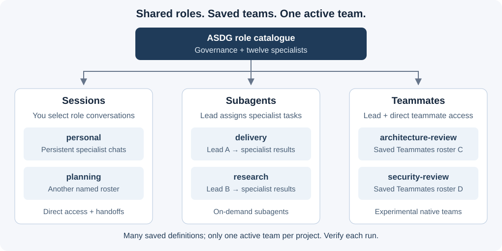

# Controlled writer and implementation inventory

This is a proposed implementation boundary, not an active exception. Source/policy changes require the appropriate explicitly assigned Admin maintenance and human review. The naming amendment updates the three materializations to Sessions, Subagents, and Teammates; it does not widen this implementation boundary.

## One mutation interface

`cli.py team …` owns specifications, generated definitions, local active-run claims, minimal run observations, and a host identity under an explicitly previewed user-local ASDG state path outside Drive. Skills gather intent and invoke it; they do not write those stores independently. Native launch uses supported Claude tools after a claim is acquired. Sessions Focus repair uses the existing adapter refresh, not this writer. Runtime-owned team storage is never an ASDG output.

Configuration creation/repair previews exact paths and bytes. Its token binds project/common-directory identity, selected type, capability evidence, spec revision, source/template hashes, existing file hashes, and current run state. Apply rechecks all inputs and fails on mismatch; unknown/custom edits require reconciliation.

Explicit start authorizes one run's acquire/update/finish transitions after a bounded start preview. Runtime events use that run's ID, generation, and allowed transition set; they do not require a human token for every callback and cannot start another run. Recovery release remains explicitly human-confirmed. Atomic locking and compare-and-swap reject simultaneous starts and stale updates.

The command permits only exact registered stores, resolves paths safely, rejects escapes/symlinks that cross the approved boundary, preserves existing files, and keeps recoverable state on partial failure. Claims go only under the resolved Git common directory's ASDG subdirectory; observations never become shared role authority. Local write receipts live in the checkout cache as write evidence only. The writer alone may use bounded temporary transaction files next to its exact outputs, cleaned up on ordinary failure, and one dedicated `write.lock` in that ASDG subdirectory serializes configuration and claim transitions.

## Required source and contract changes

| Area | Bounded proposed change |
| --- | --- |
| `skills/asdg-create-team/` and three typed skills | Claude-specific workflows, questions, generation/repair and configure/start separation; preserve existing other-client flow. |
| New `skills/asdg-team/` | Claude-only lifecycle entry point; explicit invocation; names passed as data. |
| `templates/.claude/skills/` and `.claude/agents/` templates | Separate Claude adapter namespace; its renderer reads Claude explicit-only metadata for both the shared chooser's Claude mode and the new typed/lifecycle adapters directly to emit `disable-model-invocation: true`, without changing shared `agents/openai.yaml`. Restricted worker profiles remain separate. |
| `scripts/lib/cli_team.py` and CLI dispatch | Preview/apply and run lifecycle, capability-specific results instead of blanket Claude chat support. |
| `scripts/lib/cli_clients.py`, `cli_project.py` | Client-specific discovery/rendering and ownership-aware Claude adapter refresh in roadmap step 2. Replace only bytes equal to the verified installed-build rendering; unknown or edited adapters stay conflicts. One preview/token covers new adapters and chooser replacement. Existing other-client output remains unchanged. |
| `runtime-contract.md`, session policy, Create Team rules | Narrow user-directed setup/dispatch allowance; keep each member's role receipt local. Shared run claim is not shared active-role state. |
| `write-exceptions.md` and write checker | Explicit bounded team utility/recorder exceptions for registered stores, the host identity path, owned settings entries, and Git common-directory subpath; no generic stage/application write permission. |
| Team specification and run schemas | Versioned new schemas, provenance and migration handling. Do not add keys to current `integrations.json` v1. |
| Hook observation and document controls | Proposed `cli.py team setup-observer --dry-run` / token-bound apply in increment 3 owns only its registered block in `.claude/settings.json`; preserve unrelated settings. Increment 4 extends that block for worker document controls after native tests. |
| Help, Status, onboarding, docs, package lists | Truthful supported surfaces, configuration versus activity, new companions/templates, and backward compatibility. |

All paths in this table are relative to canonical ASDG unless they name a consumer store. Validate the exact module split during implementation; companions follow executable changes. `integrations.json` migration is unnecessary unless later design requires it; any such change needs an explicit schema revision and compatibility tests.

Hook setup is a separately requested, reviewed apply; discovery itself changes no settings. Preview the owned JSON entries, module/command hashes, and removal/update behavior. Retain other hooks and refuse collisions. A human-run fallback performs the same validated apply when protected paths deny agent writes; never auto-disable the protection. The observer filters to the claim owner/session and registered worker identities before recording. Missing or unprovable identity leaves Unknown. Controls, as well as recording, are scoped: return no decision for the lead, unregistered agents, or sessions outside the active run. Deny managed worker writes on a control failure rather than treating failure as permission. Test supported `onFailure: block` behavior and version requirements. A project-wide failing hook could affect unrelated sessions before filtering; therefore prove a natively scoped control placement or keep writing Unsupported. Do not claim a harmless global fail-closed hook without that evidence.

## Verification boundaries

Retain verified installed-build rendering evidence before package replacement so refresh can compare old and candidate adapters. Bind both source identities/renderings and current file hashes in the preview token; recheck on apply. No blanket overwrite or inferred ownership from a filename. Accept a disposable installed-build-to-candidate upgrade only when new skills and the unchanged-local chooser update together, while local edits stay conflicts.

Test preview invalidation, preservation, failure recovery, exact path boundaries, concurrent starts, stale callbacks, fresh-session definition loading, explicit-only invocation, and client selection. Verify both supported and rejected actions, not merely generated file presence.

For runtime trials, use read-only tools first. Document writes need demonstrated identity/path control across all enabled mutation routes. Worker enforcement requires all worker mutation routes to be controlled. The lead needs shell access for the team CLI and remains instruction-bound in v1; do not describe its general tools or the whole team as path-enforced. V1 does not add application coding permissions; full sprint enforcement is a later reviewed increment.

This writer proposal authorizes no current commit, push, installation, trust change, or runtime launch. The delivery plan determines when each native capability can proceed.
