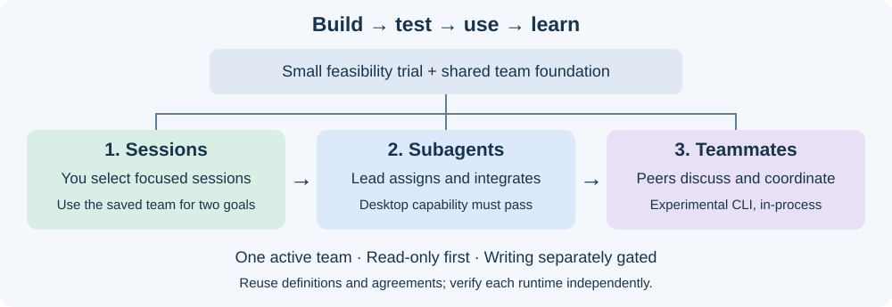

# Implementation roadmap: Sessions, Subagents, Teammates

Status: **EXECUTION UNDER WAY; naming amendment accepted.** [The naming decision](17-team-materialization-names.md) replaces the old labels; the [prior technical sign-off](14-implementer-signoff-final.md) retains its original hashes pending Claude's narrow acknowledgment. Build one usable team type at a time: Sessions → Subagents → Teammates. Each milestone ends with a real user exercise before adding complexity. This document authorizes no implementation or runtime changes by itself.

All three materializations collaborate. Sessions preserves familiar focused chats with human coordination or authorized assisted handoffs where supported. Subagents adds a lead assigning bounded jobs and integrating results. Teammates adds peer coordination using the supported experimental CLI. Reuse the same team-specification, lifecycle, and role contracts across all three; do not build three separate orchestration systems.

## Preparation — establish the small executable baseline

1. **Check feasibility in a disposable project.** Record the actual Desktop version and capabilities; prepare a minimal read-only definition by hand. Test discovery, fresh-session loading, denied worker writes/spawning, session identity, and the protected paths needed by setup. Probe event delivery using a reviewed disposable hook. Record unsupported behavior; do not install the CLI or alter Alice. This is Gate 1 in [delivery](03-delivery-and-acceptance.md). Record Teammates as Deferred here; its CLI feasibility is step 9, not a prerequisite for Sessions.
2. **Implement the shared minimum.** Under explicitly assigned maintenance scope, add the narrow policy allowances, versioned team schema, one CLI writer, preview/apply, opaque IDs, name validation, provenance, local active-run claim, and recovery. Add Claude-specific adapter routing and explicit-only metadata while preserving the other client. Add ownership-aware Claude adapter updating to the existing refresh: replace an existing adapter only when its current bytes match the rendering from the verified installed build. Preserve modified or unprovable adapters as conflicts. Preview new adapters and changed chooser together under one token; do not simply set overwrite globally. Use the [writer inventory](08-writer-and-policy.md); no general path-reservation service.

Step 2 is reviewed and delivered with Milestone 1, and may be split into several bounded reviewed changes. Its disposable acceptance must update an existing installed-build client to the candidate: add the new Claude skills, update the untouched chooser, preserve a locally edited adapter as a conflict, and leave the other client unchanged. Capture and verify the installed-build rendering before package replacement; absent trustworthy baseline evidence remains a conflict.

Preparation passes when the necessary Sessions operations work, native unknowns are recorded, and simulated state/preservation tests pass. A missing Teammates CLI does not block Sessions delivery.

## Milestone 1 — Sessions: familiar sessions with a saved agreement

3. **Build `/asdg-create-team-sessions`.** Ask the name first, then propose purpose, specialist roster, outputs, messaging/handoffs, integration owner, and completion rules. Save the reviewed specification through the shared writer. Validate existing Focus; repairs stay in the ownership-aware adapter refresh added in step 2. Reuse existing sessions when verified or guide the user to open/focus them; promise no automatic Desktop chat creation.
4. **Build the minimal lifecycle.** Add the Claude `/asdg-team` list/status/start/pause/stop/recovery/archive flow. Starting assigns a goal and bounded member tasks; enforce one managed active team. Sessions activity and stop remain human-declared. Leave ordinary Focus sessions usable, and show that they are not controlled by the team's claim.
5. **Use it twice after delivery, before proceeding.** Create an “Architecture review” team with Governance coordinating Architecture and Review. First review existing documentation without edits; then give the same saved roster a different review goal. Exercise a handoff, pause/restart, second-team refusal, and confirmed stop. Report useful findings, user effort, and any confusing status.

**Sessions done:** names and rules persist, roles stay distinct, two goals reuse the agreement, and the user can understand and operate the lifecycle. Deliver its reviewed package/adapters through a disposable client rehearsal before an authorized Alice update. Existing manual authoring authority is unchanged; this milestone claims no new automated write enforcement.

## Milestone 2 — Subagents: the lead handles specialist assignments

6. **Generate restricted workers and the creation skill.** Build `/asdg-create-team-subagents` using the same questions/specifications. Generate required `.claude/agents/` definitions with fingerprints and bounded tools; preserve custom edits and forbid repair while active. Require a fresh session after changes, then verify loading. Only the lead dispatches specialists/subspecialists.
7. **Connect dispatch, observation, and return.** Add native invocation/result routing and the reviewed managed-run observer setup. Correlate member/session IDs, collect evidence at its actual strength, and integrate results. Acquire the claim before dispatch; release after every child completes and the lead returns results. Test failure, missing observations, stale callbacks, and explicit recovery.
8. **Repeat the Sessions exercise through one lead.** Give the same review goal once; observe two bounded specialist assignments and one integrated response. Verify worker write/spawn denial, scope separation, cancellation, and reuse for a second goal. Compare user effort and result quality with Sessions, not merely whether tools ran.

**Subagents done:** actual Desktop invocation and integrated results are demonstrated, status distinguishes configured from observed, and no worker mutates the project in the read-only trial. If that native capability fails, retain Sessions and mark Subagents unavailable on that surface rather than simulate agents in prose.

## Optional writing checkpoint — keep it separate from team type

Enable bounded document-writing only after worker identity, path controls, shared-file handoff, and failure-denial tests pass for that runtime. Verify hooks do not affect unrelated sessions and disclose the instruction-bound lead. Keep workers read-only if controls are unavailable; that does not prevent a separate read-only Teammates trial. Application coding and full sprint-hook enforcement remain outside v1.

## Milestone 3 — Teammates: peers coordinate within one team

9. **Establish the supported experimental surface.** With the user's explicit choice, prepare the CLI if needed, then run a small in-process read-only feasibility trial. Verify effective settings, role loading, peer messaging, member identity, and shutdown. Desktop must report native Teammates unsupported and retain the selected type; do not substitute a dynamic workflow.
10. **Build `/asdg-create-team-teammates` and use it.** Reuse specifications, definitions, questions, and claims. Add only peer coordination and the tested native lifecycle. Run the same review goal: Architecture proposes, Review challenges, and the lead synthesizes. Test direct member interaction, one peer exchange, graceful stop, interrupted recovery, and a later goal using the saved team. Start only useful members; warn above five active teammates.

**Teammates done:** the chosen native mode is observed on the CLI, peers communicate, results are useful, and shutdown/recovery preserves the one-team rule. Document writing requires its own identity/control proof; Subagents evidence does not transfer automatically. Keep this increment independently withdrawable.

## Delivery rhythm and completion evidence

Step 5 runs in the actual client after authorized delivery; its disposable rehearsal is earlier evidence, not a substitute for that exercise. Canonical changes retain their required change records and provider-ledger receipts in addition to the milestone report.

For each milestone: bounded canonical change → focused checks → final suite/integrity check for that implementation increment → independent review → disposable install/update → authorized client delivery → user exercise. Commit/push/install/trust actions follow actual authorization; avoid repeated full suites for each minor edit.

Store a concise milestone report beside this roadmap: build/revision, surface/version, goal, members, observed actions, checks, preservation, user feedback, and unresolved limits. Record skipped/unsupported capabilities honestly. Do not mark all types ready because their files exist.

The initial executable assignment was **Preparation step 1 only**; [Gate 1](16-gate1-native-report.md) records its evidence. Continue bounded assignments under Pablo's delegated supervision. Each later assignment should cite its numbered steps, exact allowed paths, and exit evidence. After experiencing all supported individual types, assess whether teams of teams is useful; do not design or implement it in this roadmap.
