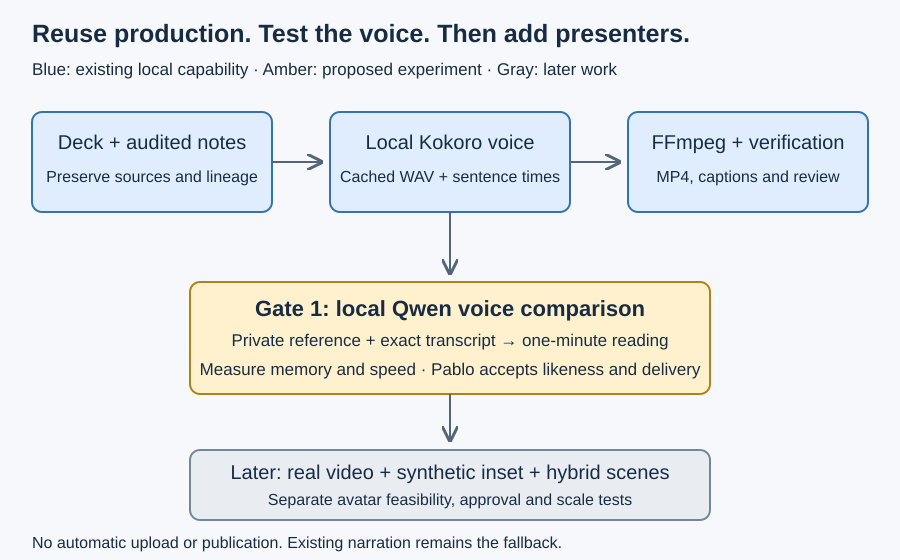

# What generated the long presentation

The referenced flagship was generated by the ignored local [publication pipeline](../../../../../build/publication-pipeline/asdg_publish_presentations.md), not the older Piper POC. Its [handoff](../../../../../build/publication-pipeline/HANDOFF.md) documents the rebuild procedure. The measured output is 39:17.604667, displayed as 39:18, rather than more than forty minutes.

## Actual production evidence

- Entry point: `build/publication-pipeline/asdg-publish-presentations`; implementation: `asdg_publish_presentations.py`, version 1.0.0.
- Input: `build/publication-pipeline/inputs/november-05-expanded-28-onboarding-corrected.pptx`; 28 slides and 5,170 normalized narration words.
- Source SHA-256: `03e16cb8cd0cbbe4d2b3fe9f5ab999a5d2915797dd7b66616230b563d7b90070`.
- Output: `build/publication-pipeline/output/nov-2026-11-05-expanded-28/nov-2026-11-05-expanded-28.mp4`.
- MP4 SHA-256: `651585625ae2963300953c4f7cbc0254e7293aa11a8c9f32462b888d69462dcb`.
- Manifest build time: 2026-11-10T01:13:17.948520Z; duration 2357.604667 seconds; 290 WebVTT cues. Fresh hashes and FFprobe match the stored manifest.

PPTX relationships determine slide order. Notes-body extraction retains original notes and records normalization/exclusions; the production derivative changes slide 2 onboarding and preserves upstream lineage. A presenter instruction on slide 22 is explicitly excluded from speech. Original and spoken text remain inspectable.

LibreOffice renders a staging deck to PDF; pypdfium2 and Pillow create 1920×1080 images and branding. Aptos is replaced by Liberation Sans in staging with font hashes; source decks remain unchanged. This handles richer PPTX layouts than the component's restricted single-image adapter.

`tts_kokoro.py` uses local `kokoro-onnx==0.6.1`, Kokoro-82M v1.0, voice `am_michael`, speed 1.1, 250 ms sentence pauses and target 135 WPM. Audited acronym substitutions preserve original caption text. Bounded FFmpeg tempo adjustment scales measured sentence boundaries to final WAV length; captions are not word alignment.

FFmpeg applies measured two-pass loudness normalization, 400 ms audio lead and 750 ms tail; durations round to 24 fps. It encodes H.264/AAC segments and concatenates them without re-encoding. Audio, render, segment and assembly caches preserve unchanged work. Outputs also include chapters, thumbnail, original notes, WAVs, per-slide manifests and provenance.

The catalog's external TTS command takes `{text}` and `{audio}` paths plus an immutable voice fingerprint. WAV sidecars supply captions and provenance. This is the existing extension point for Qwen; a second renderer or cache implementation would duplicate working functionality.

Publishing is a separate explicit command using resumable Unlisted YouTube uploads, channel checks, build markers and external credentials. No Public command exists. Stored publication records associate this build with `mNIVm6MEVJU`; live YouTube privacy was not rechecked during this discovery.

## Reusable sources and gaps

The tracked [presentation skill](../../../../../skills/asdg-presentation/README.md) owns SVG/Markdown validation, ordered narration profiles and PPTX export. The tracked [video-builder](../../../../../components/video-builder/README.md) has Piper and legacy eSpeak prototypes; Piper lacks the newer publisher's caches and publication workflow. Preserve them as explicit backends rather than selecting them as the flagship baseline.

The newest production code is ignored build material, outside the portable core distribution. Its wrapper/catalog contain absolute local paths. Promote reviewed code and companions into owned source before distribution; retain deck sources and private publication history in place. Tool versions and code hashes must participate in cache provenance. Existing audio-cache hashes do not independently bind caption/provenance sidecars; strengthen that boundary during extraction.

Fresh baseline checks: 25 publisher/text tests pass; FFprobe verifies one 1080p H.264 video and one AAC stream at 24 fps. Historical verification records include full decoding and all-slide frame checks; this turn did not rerun rendering, synthesis, decoding or listening. Original synthesis wall time and energy/cost were not established; Gate 0 still needs a measured rebuild after authorization.

The exact-source dry-run scan passes with 28 slides and no editorial blockers. Portable regressions ran 158 tests successfully with two skips. Integrity reports 26 pre-existing manifest mismatches; no manifest refresh was performed. Passing portable tests does not verify local media or voice quality.
