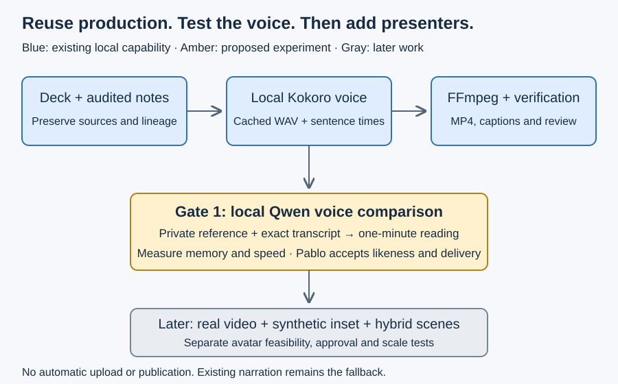

# Candidate extension boundaries

The desired outcome is one optional production workflow that preserves editable slide sources and can regenerate selected narration or presenter scenes. The following is a coordination proposal for implementation-owner review, not an accepted architecture baseline.

## Alternatives and recommendation

| Approach | Fit and consequence |
| --- | --- |
| Keep ignored publisher unchanged | Lowest immediate risk; retains absolute paths and leaves reusable behavior outside maintained source. Suitable fallback during the experiment. |
| Extract its core into existing video-builder | Recommended candidate. Reuses rendering, captions, caches, validation and provenance; requires compatibility tests and explicit source-maintenance authority. |
| Build a second hybrid renderer | Duplicates working mechanisms and splits cache/review evidence; defer unless extraction exposes an irreducible boundary. |
| Hosted end-to-end presenter service | Potential later adapter; privacy, costs and compatibility remain untested. Requires separate consent and cost approval. |

Proposed source paths are relative to the current standalone root. Nothing below has been created as implementation.

| Path | Responsibility and collaborators |
| --- | --- |
| `skills/asdg-presentation/` | Existing source authoring and deck validation; keep canonical notes/visual loading. |
| `components/video-builder/src/production.py` | Extract existing scan/render/cache/assemble/verify behavior with minimal initial behavioral change. |
| `components/video-builder/src/tts_kokoro.py` | Promote the existing adapter and its tests; retain baseline sound/settings. |
| `components/video-builder/src/tts_qwen_mlx.py` | New isolated local inference adapter using the same text/WAV sidecar contract. |
| `components/video-builder/src/scenes.py` | Later scene compilation for narration-only, real footage and synthetic inset/full-frame scenes. |
| `components/video-builder/types/production-contract.md` | Versioned manifest, voice result, scenes and measured timing contract. |
| `components/video-builder/tests/` | Port production regressions; add adapter, scene, cache and recovery acceptance cases. |
| `skills/asdg-presentation-produce/SKILL.md` | Optional thin agent procedure calling maintained scripts, if a distinct workflow is justified. |

Each maintained Python module requires its Markdown interface companion. Generate native discovery adapters only through existing templates after their scope is reviewed. Presentation tools currently stay outside the core ZIP: do not widen `metadata/package-files.json` or the installer as part of this experiment. Determine optional tooling delivery separately.

## Candidate contracts

Normalize source adapters into stable slide/segment IDs, visual hashes, original notes, reviewed spoken text and exact normalization audit. Keep visual rendering independent of inference. Use sentence or short-paragraph generation for local Qwen and measure final PCM samples; do not estimate new timings from old Kokoro audio.

A voice result returns WAV, sample rate, sample count, measured caption intervals and private provenance. A scene references this result or a real recording and declares trims, slide bounds, overlay rectangle, fit policy and optional synthetic label. Reject incompatible assets or out-of-bounds trims before encoding; real footage retains original voice unless explicitly configured otherwise.

Cache keys include text, pronunciation lexicon, model/tokenizer/reference hashes, runtime/adapter versions, sampling settings and seed where supported. Audio cache excludes visuals; scene cache includes layout/visual/audio hashes; assembly cache includes ordered scene hashes and encoding configuration. Validate all associated sidecar hashes on reuse. Write atomically; interruption never turns partial output into a cache hit.

Deterministic orchestration means stable inputs, commands, timing calculations and cache decisions. Neural synthesis and encoders need measured repeatability; do not promise cross-version byte-identical audio/video. Record actual outputs and pin environments.

Use private media storage outside Git **and outside this Google Drive-synced checkout**. A Git ignore rule alone does not prevent Drive upload. Public manifests reference profile IDs; private reference hashes, embeddings and paths stay in private run records. Renderer and voice modules have no credential or upload dependency. Preserve the existing publisher as an explicit separate adapter.

Proposed sequence: measured Gate 0 baseline → Gate 1 voice comparison → Gate 2 isolated 15–30-second avatar compatibility test → Gate 3 two-minute hybrid sample → Gate 4 40–50-minute scale/recovery check. Qwen produces speech, not an animated face. No avatar engine is selected or locally benchmarked yet.

Stop before each stage whose prerequisite quality review or explicit operational authorization is missing. A later change must not silently overwrite current decks, caches, credentials or upload records. Cloud execution is a reconsideration option only after local measurements and a separately approved privacy/cost decision.
