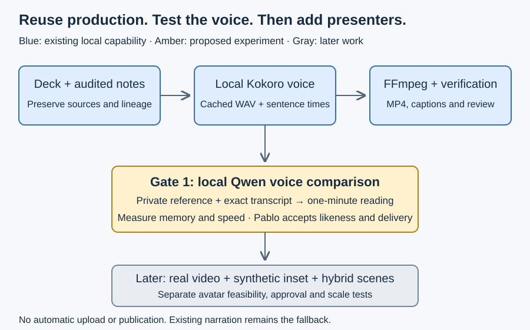

# A minimal local voice comparison

The experiment asks whether a small local clone sounds sufficiently like Pablo for technical narration. This is a prepared protocol, not an executed POC or a model-quality claim. The actual machine reports Apple M5 and 16 GB RAM; the plan's MacBook Pro/32 GB assumption does not match this host.

## Candidate and verified upstream facts

[Qwen's repository](https://github.com/QwenLM/Qwen3-TTS) distinguishes Base cloning models from CustomVoice presets and VoiceDesign. Choose `mlx-community/Qwen3-TTS-12Hz-0.6B-Base-bf16` first; do not use a preset voice model for cloning. Its [model card](https://huggingface.co/mlx-community/Qwen3-TTS-12Hz-0.6B-Base-bf16) identifies an MLX conversion and Apache-2.0 license; the [file tree](https://huggingface.co/mlx-community/Qwen3-TTS-12Hz-0.6B-Base-bf16/tree/main) reports about 2.52 GB including tokenizer assets. This is download size, not peak runtime memory.

[MLX Audio's cloning example](https://github.com/Neywa-Labs/mlx-audio/blob/main/mlx_audio/tts/models/qwen3_tts/README.md) accepts local reference audio and its exact transcript; no preset speaker should accompany a Base clone. The [runtime](https://github.com/Neywa-Labs/mlx-audio) is MIT-licensed. Pin a reviewed runtime commit, model revision and tokenizer files before requesting download approval. Weight/runtime attribution must accompany any later redistribution; verify the exact downloaded licenses then.

This is zero-shot reference conditioning; no fine-tuning is needed for the first test. Qwen documents cloning from around three seconds. Propose one clean 10–20-second reference with a manually checked transcript, rather than requiring a five-minute capture. Keep a different reading of the test passage for comparison. Longer reference kits are a later quality experiment.

MLX Audio is the native Apple Silicon candidate; upstream CUDA/FlashAttention examples are not evidence of Mac compatibility or speed. Default Python here is 3.15; Python 3.11 is also available. MLX/MLX Audio are absent from the default runtime. Use a separate Python 3.11 environment after dependency approval; do not alter the Kokoro environment. Hardware fit is plausible but unmeasured. Defer 1.7B until the smaller model is tested and any additional download is approved.

## Proposed run

1. Approve exact dependencies/model revision and a non-synced private local destination; inspect disk space and memory pressure. Stop if dependencies or hidden assets exceed the approved scope.
2. Pablo supplies his own consented reference WAV/transcript in that private destination and reads the comparison passage separately. Do not fetch a voice from YouTube or Drive.
3. Inspect the reference for clipping, silence and multiple speakers. Preserve the original; derive mono PCM locally. Manually transcribe it; supplying literal `ref_text` avoids automatic ASR/model downloads.
4. Generate a 10-second smoke test, then the approximately one-minute [technical passage](04-commands-and-passage.md). Compare Qwen, current Kokoro and Pablo reading exactly the same words. Keep raw and loudness-matched listening copies.
5. Record cold load, warm synthesis wall time, output seconds, real-time factor (wall/audio), peak memory, memory pressure, all settings and hashes. Run the minute sample twice without changing settings; evaluate stability, not assumed byte identity.
6. Disable network for inference after approved assets are local. Missing local assets must fail rather than download. Save private WAVs, metadata and listening scores; expose no personal recordings in Git or synced folders.

## Acceptance proposed for human review

| Check | Proposed pass condition |
| --- | --- |
| Privacy and locality | Local paths only; inference succeeds with network disabled; no new model fetch, telemetry or upload; private artifacts remain outside synchronized folders. |
| Input rejection | Missing consent/reference/transcript/model, empty text, unsupported sample format and preset-speaker conflict fail before inference. |
| Signal integrity | Finite, nonempty mono PCM; zero clipped samples; approximately 45–90 seconds for the test; unexpected silence over two seconds flagged for listening. |
| Content | Full listening finds no missing, repeated or invented sentences; all glossary terms intelligible; any independent ASR check is advisory and local-only. |
| Human likeness | Pablo scores identity, accent retention, pronunciation, intonation and intelligibility from 1–5; proposed threshold ≥4 in every category and explicit willingness to use it. |
| Operation | Both runs complete without OOM/crash; proposed warm RTF ≤5 and process peak memory ≤10 GB on this 16 GB host, with no sustained severe memory pressure. Report failures separately from voice quality. |
| Provenance/cache | Bind model/tokenizer/runtime/text/reference/settings to result hashes; same completed job reuses artifacts; changed text/reference invalidates audio; interrupted output is never reused. |
| Caption adapter | Measured sentence intervals are monotonic, inside WAV bounds and cover the original text. No invented word timing; CLI-only smoke audio is not yet an integrated caption result. |

These thresholds are proposals, not accepted requirements or passed tests. Failures trigger correction or stop; a low-quality voice blocks avatar work. No listening comparison, M5 inference benchmark or reference-media processing has run in this discovery.
