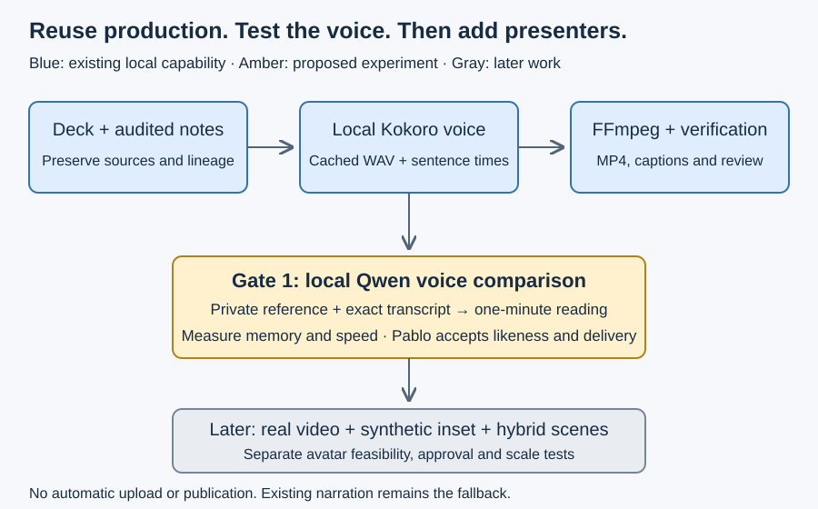

# Hybrid avatar presentation production

This proposal helps Pablo reuse the existing presentation pipeline for narration, real recordings and optional synthetic presenters. Discovery was performed on 10 November 2026; no implementation or model installation is approved by this document.

The proposed decision is to consolidate the working Kokoro pipeline into the existing video-builder component, retaining `asdg-presentation` as the source-authoring workflow. Add an optional production skill only as a thin orchestration entry point. Local Qwen inference is the first candidate extension; avatar inference remains a later, independent experiment.

Read [the verified inventory](01-existing-pipeline.md), [candidate extension boundaries](02-extension-proposal.md), [voice experiment and acceptance](03-voice-experiment.md), and [commands and comparison passage](04-commands-and-passage.md).

The [supplied handoff](https://docs.google.com/document/d/1pBhLHX4HM7bGPyx4n2M5o8e7E_KcK-b8ZnaN5D43W2s/edit) describes the intended outcome. The [Start Here index](https://docs.google.com/document/d/1SNBGh22V1F5dy_s-xPUbu3d3YECdpzX5y9XAlt5_Q3g/edit) and [Presentation Library](https://docs.google.com/document/d/1E6m1WUGApqe-uwJb6VRp2kj2snbLBnBaWJw4cfU5CRk/edit) led to the actual local publisher. Their older canonical-repository references require reconciliation with the current checkout; they do not authorize a migration.

The observed root is `Elustondo-ai/asdg`, branch `main`, commit `426e678` (`baseline Nov 9`), initially clean for tracked and ordinary untracked files. Ignored build assets exist. The README still describes cutover as pending review; a commit and remote name alone do not establish cutover approval. No client initialization or second sprint state was created.

Governance owns this evidence reconciliation and routing proposal. Architecture and experiment details below are candidate requirements for owner review, not accepted specialist deliverables. No specialist or Admin role was activated and no delegation occurred.

Next bounded assignment proposed: explicitly select ASDG Admin for source-tool consolidation and the local experiment harness, preserving governance and agent definitions. A scoped implementation decision, dependency/model approval and consented local reference path remain separate prerequisites. Stages 05 and 06 are relevant reviewers if specialist review is requested.

No commit, push, publication, recording upload, model download, dependency installation, or production-code edit occurred. Only this coordination documentation was added. A later rollback removes only the approved experiment environment/output, preserving current source decks, caches and publication history.

Acceptance of this proposal would select an approach; it would not approve future model bytes, generated audio or a public release. Revisit local-first execution if measured quality or memory fails, or if a separately costed and consented external adapter is preferred.

Exact documentation hashes and verification limits are recorded in [the adjacent review receipt](review.json). This package is a review draft.
