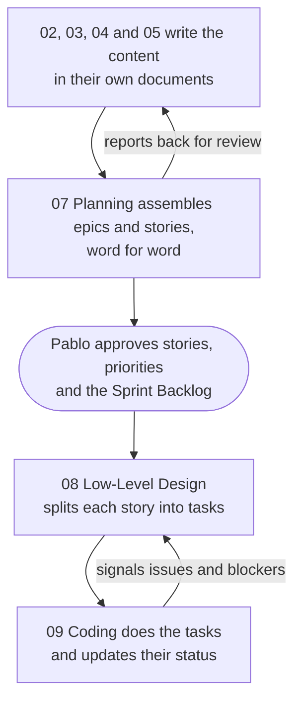

# Who owns the plan: vocabulary and roles

A project's plan is made of epics, stories and tasks. This record sets the words ASDG uses for them and which role is responsible for each part, wherever the plan is kept: planning documents, the plan file or GitHub.
Pablo selected this division on 25 November 2026 by comparing ASDG's roles with a bank delivery team. The role definitions do not say this yet; the [proposed changes](01-role-changes.md) list what would have to be edited.

*Content flows down from the specialists; review and problems flow back up to whoever owns the words.*

## Vocabulary

| Term | Meaning |
| --- | --- |
| Epic | A group of stories with a common theme and purpose |
| Story | One thing a user needs, with its acceptance criteria |
| Task | A piece of work needed to finish a story; a child of that story |
| Product Backlog | Every story that could be done, in priority order |
| Sprint | A fixed period of work with one goal |
| Sprint Backlog | The stories chosen for one sprint, with their tasks and the sprint goal |

These are the usual agile and Scrum terms. They are used even where GitHub names things differently.

## Who owns what

| Role | Like, in a bank team | Owns | Does not do |
| --- | --- | --- | --- |
| 02 Purpose, 03 Use Cases, 04 Benchmarks, 05 Architecture | Business person, business analyst, specialists | The words of epics and stories: the why, the scenarios, the acceptance, the constraints | Project bookkeeping |
| 07 Planning | Project manager, Scrum master | Assembling those words into epics and stories, reporting the result back, and making the collaboration happen | Writing or rewording content |
| 08 Low-Level Design | Technical team lead | Splitting a story into tasks, the words of each task, and answering issues raised on it | |
| 09 Coding | Developer | Doing tasks, updating their status, commenting, and signalling issues and blockers | Changing what a task is |
| Pablo | Product owner | Approving stories and priorities; starting and closing sprints | |

## Selected, and still proposed

- **Selected by Pablo:** the six terms, the table above, and that the role definitions must be updated so every specialist knows its part, Planning first.
- **Proposed, not yet decided:** each copied piece of text carries a link to its source and the source's hash, so a stale copy can be detected; and Planning reports a gap to the owner instead of filling it with its own words.
- **Open:** whether a story's status follows from its tasks or is set at review, and whether stages 01 and 06 also supply story content.
- **A limit:** GitHub lets anyone with write access edit any field. These responsibilities bind the ASDG roles; only changes that pass through the sync can be checked.

This record describes a selection. It approves no document text and changes no role definition; exact words and hashes are in the [receipt](review.json).
