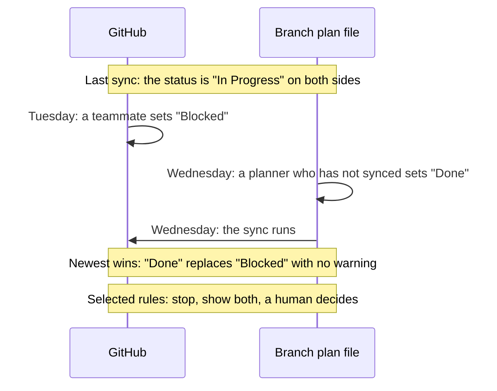

# Sync authority: the alternatives and one example

Four ways to settle a difference between a branch's plan file and GitHub were considered before Pablo selected the [three rules](README.md). One small example separates them.

*The planner's edit is newer, but it was made without seeing Tuesday's change.*

## The options

| Option | What it does in the example | Main weakness |
| --- | --- | --- |
| GitHub always wins | Keeps "Blocked" and drops "Done" | A planner's work on a branch is discarded, and GitHub can be out of date too |
| The branch always wins | Writes "Done" over "Blocked" | Every branch overwrites the shared plan, which is the original problem |
| The newest change wins | Writes "Done" over "Blocked" | An edit made on old information silently replaces a newer fact |
| Compare with the last sync; a human settles real conflicts (selected) | Stops and shows both values with time and author | Needs a stored last-sync value and reliable change times |

The first option is the model in the original [handoff](../../github-planning-handoff.md): GitHub owns the published fields and the branch holds a snapshot. It is the simplest to build. It was set aside because planners do make legitimate changes on a branch, and Pablo's stated view is that either side can be the outdated one.

## How the selected option relates to Git

| Selected rule | The same idea in Git |
| --- | --- |
| The last-sync value | The merge base: the last version both sides shared |
| Only one side changed: take it | A clean merge, applied without asking |
| Both sides changed the same field: stop | A merge conflict that a person resolves |
| An old branch value is a leftover | Git does not re-apply a commit that history shows is already behind |

Git knows the history of every line. A plan file and a GitHub Issue hold only current values, so the sync must store the last-sync value itself and use change times where Git would use history.

## Evidence and uncertainty

- **Reproduced:** with the current merge code, a plan file whose current value is older than its stored last-sync value pushes that old value to GitHub and reports no conflict. Details are in the [findings receipt](../../reports/2026-11-25-plan-sync-findings.json).
- **Read from the code:** today's engine compares each field with a stored last-sync value and stops when both sides changed. It records no change time or author for a field.
- **Not verified:** which change times GitHub exposes for an Issue's title, body and state and for each Project field, and whether an Issue's update time also moves on comments. The pilot must check this before rule 3 relies on it.
- **Not measured:** how often real planning produces a conflict under these rules.
