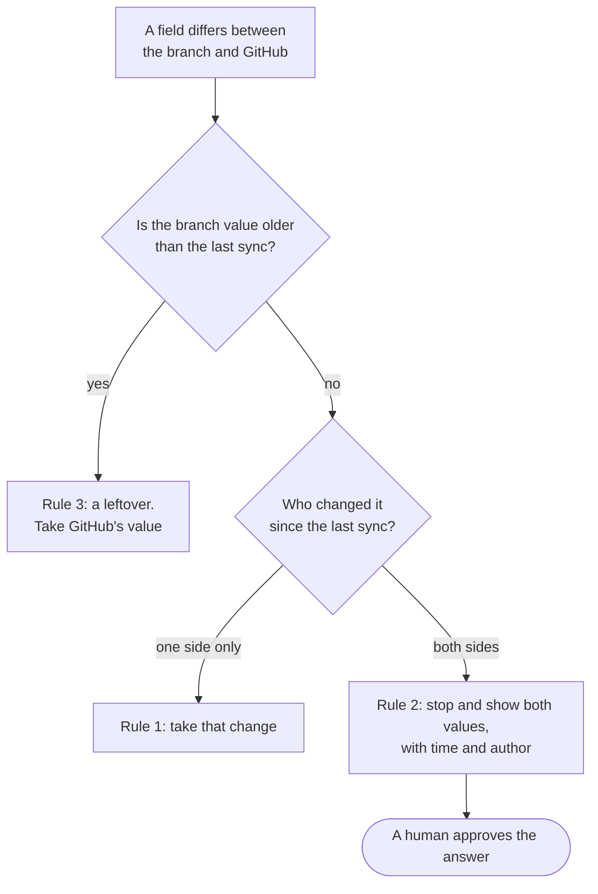

# Which side wins when the plan differs: three sync rules

Project Plan Sync keeps a project's stories in two places: a plan file in each branch, and GitHub Issues with one Project. This record settles what the sync does when the two disagree.
Pablo selected the three rules below on 25 November 2026. They answer the first open decision in the [proposed next steps](../../reports/2026-11-25-plan-sync-next-steps.md); the [comparison](01-comparison.md) explains the alternatives.

*How one differing field is handled. Only the last path needs a person.*

## The rules as selected

| Situation | What happens | Who decides |
| --- | --- | --- |
| Only one side changed since the last sync | Take that change | Nobody; it is safe |
| Both sides changed the same field | Stop and show both values, with time and author; the newer one is the suggested answer | A human approves |
| A branch value is older than the sync it is compared against | Treat it as a leftover, not as a change, and take GitHub's value | Nobody; it is safe |

"Last sync" is the value both sides shared when a sync last completed for that field. Neither GitHub nor the branch is the authority because of where a value lives: both can be out of date.

## Why this choice

Both sides produce real changes: a planner edits stories on a branch, and a teammate updates the board on GitHub. A rule that always trusts one side discards the other side's work.
Time alone cannot separate a deliberate change from one made on old information, so it advises the human and never decides a conflict by itself. This is the idea behind Git's three-way merge, applied to the fields of a story; the times supply what Git learns from its history.

## Consequences

- **The two-way engine stays.** It already applies rule 1 and already stops on rule 2. It does not yet show time and author, suggest an answer, or apply rule 3.
- **The sync needs change times on both sides.** GitHub is expected to supply them for Issues and Project fields. How the branch side records when a value changed is not designed yet.
- **Rule 3 is meant to remove the stale-value push** in finding 6 of the [findings](../../reports/2026-11-25-plan-sync-findings.md). That holds only once it is implemented and tested.
- **This comes before the request-cost work**, because it changes what the sync must read. A second review of the findings recommended the same order.

## Still open, and when to revisit

- Where the last-sync record is kept: in the branch file, as now, or outside it.
- Whether a story or sprint scope that Pablo approved gets extra protection against later edits. These rules cover the sync only.

Revisit the rules if conflicts become frequent enough that asking a person slows planning, if the branch side cannot record reliable change times, or if a live pilot shows GitHub's times to be missing or misleading.

This record describes a selection. It approves no document text, changes no code and starts no work; hashes and checks are in the [receipt](review.json).
