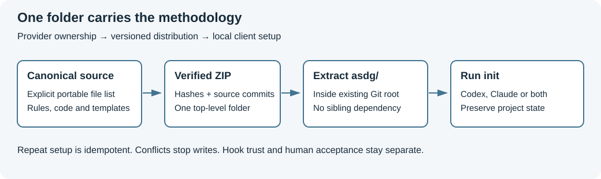

# ASDG canonical baseline review — 24 November 2026

This checkout is the source for maintaining ASDG and distributing reviewed changes to client projects. It matches GitHub `main` at `c34f4a753de6c6dfed59f824aaa273832a50a089`, but its current package is not ready for distribution.

The distribution diagram explains the source-to-client boundary. Its SVG was rendered at 800 pixels wide and visually inspected: all four steps and labels are legible. This was an asset check; a rendered Markdown preview was unavailable.

## Verified baseline

- GitHub branch heads were read directly after a successful fetch. Local `main` and cloud `main` agree; the initial working tree was clean.
- Cloud also contains `claude-team-materialization` at `331b92e51cea0876c62e4eb756b6d5966827f022`. It is divergent, rather than a later version of main.
- Its three foundation modules (`cli_team_claim.py`, `cli_team_model.py`, `cli_team_store.py`) are byte-identical to main. Its design/review package under `docs/asdg/00-governance/decisions/claude-team-materialization/` is absent from main. Preserve the branch pending evidence reconciliation; merging it wholesale is not recommended by this assessment.
- [The structural checker](../../../../scripts/check.py) passes for governance 00, twelve specialists, links, skill front matter and Python 3.9 syntax.
- Integrity verification fails on 96 selected paths. [The manifest](../../../../metadata/MANIFEST.json) was not updated with the promoted files. [Upgrade](../../../synchronization.md) explicitly requires a matching manifest.

## Findings requiring maintenance

The highest-priority issue is the stale delivery manifest. Review the promoted bytes and tests before rebuilding the manifest; a new manifest establishes content identity, never approval.

A second issue is reproducible in [released claim validation](../../../../scripts/lib/cli_team_claim.py): change a valid released record's `end_kind` to an empty list, then call `read_claim`. Dictionary membership raises an uncaught `TypeError`, rather than returning `UNREADABLE`. The reproduction used a disposable Git project and fixture host identity only. Reject non-string values and add meaningful regression coverage before rebuilding the package.

[The README](../../../../README.md) still describes canonical cutover as pending review and commit. That wording needs reconciliation with the repository's actual source-of-truth status. Native team materialization, hook trust and application behavior were not verified in this review.

## Local client comparison

Only the actual 463 selected distribution files were compared; source-only exclusions are not client defects. This comparison does not establish client cloud freshness or native integration health.

| Client checkout | Observed methodology |
| --- | --- |
| `alice.good.meetings` | All 463 selected files match canonical, including the stale manifest. Existing application/documentation edits were preserved. |
| `lifebuckets` | 367 selected files match; 43 differ; 53 are absent. Its recorded build is `f2b8591`. Upgrade needs a reviewed comparison preserving state and local changes. |
| `elustondo.ai.web` | No embedded `asdg/`; local Git has no commits. Do not infer a successful install from this checkout. |
| `elustondoaiweb` | Separate personal-origin repository on `asdg-introduction`; no embedded `asdg/`. Its relation to the intended web client is unresolved. |

## Assessment and next work

Intended: the user identifies this folder as the official source. The lifecycle baseline preserves governance 00 and stages 01–12; no new exact-state release approval was provided.

Actual: current cloud main and Alice's selected methodology are present here; integrity and malformed-state handling prevent an unqualified readiness claim. The full suite ran 246 tests in 294.031 seconds: 243 passed and three optional presentation-rendering checks were skipped; no failures. The separate malformed-state reproduction demonstrates a coverage gap despite this passing suite.

Planned: no Stage 07 maintenance commitment was established by this assessment. Proposed sequence: repair claim validation, reconcile branch evidence and stale explanatory text, rebuild/review the manifest, rerun required checks, then preview each client upgrade separately. Client troubleshooting follows this baseline review.

This Governance review changes no methodology definitions, client files, sprint state, approvals, branch history or release state. Agent-applied definition changes require explicit ASDG Admin selection under the [root instructions](../../../../AGENTS.md). This report and its exact-hash receipt are coordination documentation, not a release approval.
