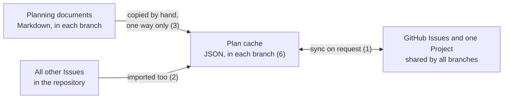

# Project Plan Sync: what exists and what blocks a first real use

Project Plan Sync lets Planning share a project's stories and sprint backlog through GitHub Issues and one GitHub Project, so that teams on parallel branches see one plan instead of one plan per branch.
This report records what was found in the canonical repository on 25 November 2026, on branch `project-plan-sync` at commit `496ced2`. Its companion lists the [proposed next steps](2026-11-25-plan-sync-next-steps.md).

*The three copies of a plan and the paths between them. Nothing flows from GitHub back into the planning documents. The numbers point to the findings below.*

## Intended, actual and planned

**Intended.** The [handoff](../github-planning-handoff.md) asks for discovery and a read-only first milestone. No approved design for a two-way sync was found in this repository.

**Actual.** A two-way sync is already implemented: an [engine](../../../../scripts/lib/cli_plan_sync.md), a [field merge](../../../../scripts/lib/cli_plan_merge.md), a [GitHub transport](../../../../scripts/lib/cli_plan_github.md), a [skill](../../../../skills/asdg-project-plan-sync/SKILL.md), a [guide](../../../project-plan-sync.md) and the `project-plan-sync` command. Its 72 tests pass and the full suite passes (389 run, 9 skipped), all against a simulated GitHub. The handoff was written from a second local checkout that did not contain this code, which explains the difference.

**Planned.** No Stage 07 work item, decision record or review receipt for this feature was found.

## Findings

1. **A first sync of a real backlog would exceed GitHub's hourly request allowance.** The engine reads the complete remote state before and after every single write, each read asks GitHub once per Project item, and each Project field is a separate write. The table below gives the simulated cost. GitHub documents 5,000 [REST requests](https://docs.github.com/en/rest/using-the-rest-api/rate-limits-for-the-rest-api) and 5,000 [GraphQL points](https://docs.github.com/en/graphql/overview/rate-limits-and-query-limits-for-the-graphql-api) per hour for a personal token, so a sync of 30 new stories is expected to stop part-way and wait for a later `--resume`.
2. **Every Issue in the repository becomes a plan item.** The read takes all open and closed Issues, and the merge imports each one that is missing from the cache and adds it to the Project. No label, marker or query limits the sync to planning items, so a repository that also uses Issues for bugs or questions gets all of them on the planning board.
3. **Planning does not yet use the shared plan.** Stories reach the cache only when someone copies them from the planning Markdown by hand; the engine deliberately never reads prose. Nothing writes GitHub's values back into those documents, and the [Planning procedure](../../../../07-planning/skills/prepare-plan/SKILL.md) gained one sentence that points to the sync. A planner on a branch therefore still plans from that branch's documents, which is the problem the feature set out to solve.
4. **The seven fields are thinner than a real backlog.** The cache holds title, body, open or closed, status, priority, team and sprint. A client backlog read on the same day also carries a size, dependencies between stories, an acceptance idea and an owner. Today these can travel only as free text in the Issue body, and the sprint is a text label without dates.
5. **No live run exists, and its prerequisites are unverified.** Every test injects a simulated GitHub. The shell used for this review had no `gh` command and no `GH_TOKEN` or `GITHUB_TOKEN`; a real run needs a token that can write Issues and Projects for the pilot repository's owner.
6. **The cache is committed, so branches still merge the plan as text.** The cache keeps each item's current values and its last synchronized values (`base`) in the branch. When two branches sync at different times and are later merged, Git merges that JSON line by line. A resolution that keeps current values from the older side and `base` from the newer side makes the next sync push the stale value to GitHub without reporting a conflict. This was reproduced with the merge function alone.

| New stories in a first sync | Writes | Complete remote reads | Read requests (estimate) |
| --- | --- | --- | --- |
| 10 | 60 | 125 | 1,390 |
| 30 | 180 | 365 | 7,710 |
| 60 | 360 | 725 | 26,190 |

## How the evidence was produced, and its limits

The cost figures come from running the real engine against the test suite's simulated GitHub and counting, for every complete read, the requests the transport would send: four fixed requests, the Project item pages, one request per Project item and the Issue pages. They are an estimate from reading the source, not a measurement against GitHub.
The procedure, source line references and commands are in the [receipt](2026-11-25-plan-sync-findings.json).

This review read the code, its companions and tests, and ran the suites. It inspected no live GitHub Project, did not review push replacement, which shares the branch, and changed no code.
All code on the branch was written in an earlier Codex session; the [test companion](../../../../tests/test_plan_sync.md) discloses that the test author also wrote the skill guide.
