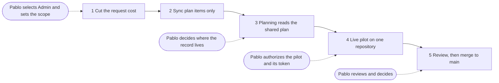

# Project Plan Sync: proposed next steps

This proposes how to take the existing two-way sync from "passes simulated tests" to "one real project uses it", removing the blocking problems first.
It is a proposal for Pablo and a second reviewer. Nothing here is approved, scheduled or started, and it establishes no Stage 07 commitment. The reasons are in the [findings](2026-11-25-plan-sync-findings.md).

*The proposed order of work. Rounded boxes are human decisions that must come before the step they point to.*

## Steps

| Step | Change | Done when | Rough effort |
| --- | --- | --- | --- |
| 1 | Read the complete remote state once per run and re-read only the touched Issue or item after a write; fetch field values together with the item list | The 30-story simulation needs under 1,000 requests instead of 7,710, and every recovery test still passes | 1 to 2 days |
| 2 | Manage only Issues that carry the ASDG marker or a chosen label; leave every other Issue and Project item untouched | A preview on a repository with unrelated Issues proposes no change to them | About 1 day |
| 3 | Make the shared plan an input of the Planning procedure, and settle how backlog pages relate to the cache | A planning report traces each item to its Issue, and a second branch sees the same stories without copying files | 1 to 2 days |
| 4 | Run preview, apply, conflict and resume against one authorized repository and Project | The handoff's acceptance list is met with recorded evidence, including real request counts | 1 to 2 days |
| 5 | Independent review of code and documents, receipts, then merge | Pablo's decision on the exact reviewed state | Review time |

The total is about 4 to 7 working days before review. That is below the handoff's 6 to 10 because the engine already exists; both figures are estimates, not commitments.

## Decisions for Pablo

- **Where the record lives.** Keep the symmetric two-way merge, or treat GitHub as the record for shared fields and the branch file as a working copy, as the handoff describes. This also settles finding 6: a working copy can live in the ignored `.asdg/cache/` instead of the branch.
- **Pilot target.** Which repository and Project, and whether the sync creates the Project or uses an existing one.
- **Field set.** Whether size, dependencies and item type join the seven fields before the pilot or after it.
- **Push replacement.** It sits in the same commit, `b720cb2`. Review it together with the sync, or split it out first.
- **Who changes the code.** Methodology code changes need ASDG Admin, explicitly selected by Pablo with a bounded scope.

## For the reviewer

- All code on the branch came from an earlier Codex session. This review added only these two reports and their receipts.
- Step 1 trades repeated complete reads for targeted ones. Those reads are the engine's protection against concurrent edits, because GitHub offers no compare-and-swap, so the recovery and concurrency tests deserve the closest look.
- The cost figures in the findings are simulated estimates. The live pilot should record real request counts and the token permissions that were actually needed.
