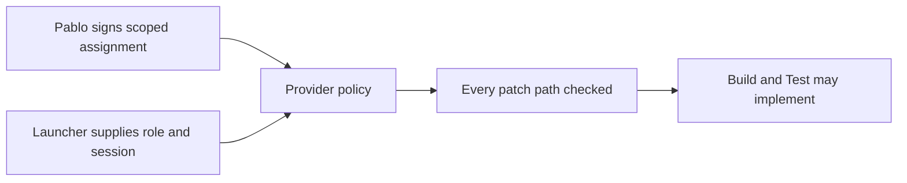

# Provider component workflow review

Pablo authorized ASDG Admin to implement a source-only development workflow for ASDG-09. This local candidate awaits Pablo's review. The baseline is main at 426e6783cccd3a9285776473fb0a98de83c6a0ae. The seven previously untracked discovery artifacts were preserved.

The [provider contract](../../../scripts/provider_component/policy.md) defines the approval and scope. The [guard contract](../../../scripts/provider_component/guard.md) describes runtime integration. ASDG-09 uses the signed provider path for standalone component work. Initialized clients continue through the ownership and sprint policy. The optional modules and tests are excluded from the core package list.

Seven provider tests passed using temporary Git clones, real SSH signatures and a fixture verification key. Positive checks covered both shared preflight and the patch guard. Negative checks covered altered, unsigned and wrongly signed assignments, Admin, stale revision, session and repository mismatch, unauthorized mixed paths and moves, protected files, links, traversal, client roots and package membership.

The portable suite ran 158 tests with two skips. Structural checks passed. Integrity checks returned the same 26 pre-existing path mismatches. The [receipt](02.11-review-provider-component.json) classifies them and binds manifest, starting and final bytes. Three pre-existing mismatch paths changed in this iteration. The shipped file list was preserved.

The signing choice is OpenSSH with an operator-provisioned Pablo trust anchor. No real key was enrolled, no native hook was installed or observed, and no component assignment was issued. Enforcement depends on a trusted launcher supplying current role/session and mediating write-capable tools. Tests cover policy evaluation, not native enforcement or concurrent filesystem mutation between a preflight and a write.

This report and its adjacent receipt carry the documentation hashes. Admin's standalone preflight rejected the canonical ledger path, so that ledger was not updated. Diagrams were checked as source only. Review this diff before any operator setup or separate ASDG-09 selection.
