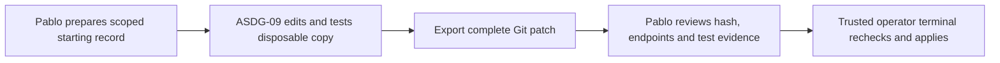

# Disposable provider component workflow review
Pablo authorized ASDG Admin to replace detached signing with a disposable implementation copy and human-applied Git patch. This local governance change begins at `426e6783cccd3a9285776473fb0a98de83c6a0ae`. The earlier [implementation report](02.11-review-provider-component.md) records the superseded design and the original integrity baseline.

The [operator procedure](../../../scripts/provider_component/review.md) gives the exact commands and assignment schema. The common evaluator validates all file endpoints Git reports in both directions. The confirmation token binds exact patch bytes, repository, original assignment, acceptance criteria, revision and relevant starting working and index state.
The [receipt operation](../../../scripts/provider_component/receipts.md) computes AI-MODIFIED entries for Admin-owned, in-scope Markdown from source bytes. A direct write declaration for the ledger remains denied. Existing client ownership and sprint rules continue through their existing evaluation path.
## Real Codex run
Codex CLI 0.162.1 ran an ephemeral ASDG-09 fixture in a separately cloned checkout. The run used workspace-write, approvals set to never, user configuration and exec rules ignored, apps disabled and both shared temporary roots excluded. This tests the specified CLI configuration. The desktop Admin session has wider maintenance access.
The native patch tool created an eleven-byte `components/governance-probe/result.txt` in the clone. The router rejected an absolute-path patch into the authoritative checkout. A direct shell exclusive-create at a different authoritative path returned errno 1. Independent readback found both authoritative probe paths absent. The session exported the candidate successfully.
The trusted preview identified only that fixture path. Patch SHA-256 was `65081ff52580f9309e2b8e4205d91ef14e9f8bacbcad404fd18c93291c69e25c`. Actual patch application was tested in disposable fixtures. The authoritative source received no fixture patch.
An earlier shell probe stopped while preparing a here-document. The successful run used a direct Python command. The first nested broker launch required host consent to start its app server. Each implementation tool retained the child sandbox.
## Regressions and review
Ten provider tests cover actual Git changes and rename endpoints, fresh and stale approvals, dirty inputs and index state, ignored files, direct declaration rejection, client and package boundaries, and receipt semantics. The portable suite ran 158 tests, with two renderer dependency skips. Structural checks passed.
The original 26 mismatch paths consist of 22 changed files and four package entries missing from the historic manifest. The final set matches that baseline. This iteration changed bytes on four already-listed paths. The historical manifest and portable file list were preserved.
The [evidence receipt](02.12-review-disposable-component.json) records scoped hashes and native outcomes. Operator review remains pending. This change makes no Video Builder assignment and records no human approval of the resulting bytes.
