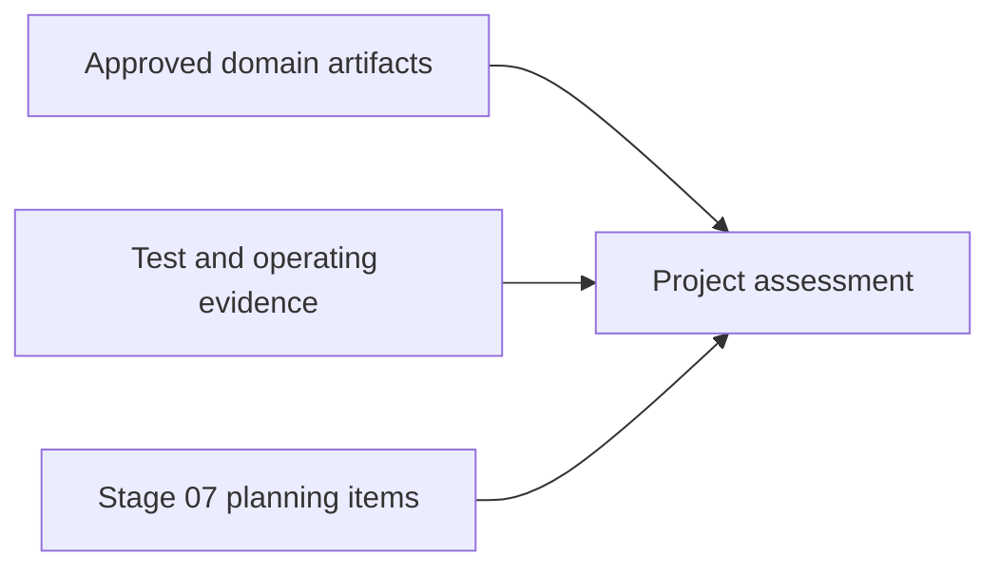

# Lifecycle documentation cleanup — owner review

Pablo requested this maintenance under ASDG Admin in the standalone provider at `426e6783cccd3a9285776473fb0a98de83c6a0ae`. The four owner-applied write-control files matched the reviewed patch. The two previously denied targets passed their exact-path checks. The checker still reserved its own executable for the owner.

## Applied to the provider

The [layout](../../../00-governance/docs/stage-layout.md) assigns engineering artifacts to specialists. [Planning](../../../07-planning/types/contract.md) integrates objectives, progress, gaps and future work. The [snapshot](../../../00-governance/docs/stage-snapshot-template.md) asks for sources and unknowns. A [Purpose review](../../../02-purpose/types/completion.md) can bind one illustrated statement, its navigation and any registered supplements. Agent readiness and human acceptance remain separate decisions.

The patch removed 36 tracked perspective markers and two superseded role drafts. It preserved existing client material, history and all twelve specialist identities. Git tracks the marker deletions. On this checkout the path checker reserves directory operations, so empty working directories can remain locally.

## Remaining owner decision

The initializer still ships the previous stage introductions. The exact-path checker also reserves protected skills, package metadata, stage log files and regression sources. The separate owner patch updates those together, removes 50 additional files and retains the legacy log ignore rules. Use the incremental owner patch against this reviewed working state. The combined diff includes the already-applied portion.

## Verification

The authoritative portable suite ran 160 tests with two renderer skips. All ten provider tests passed. An external 17-case Purpose suite ran against the authoritative module. The package structure check passed. The historical enclosing-layout suite reproduced its fixture errors on the starting snapshot.

The original delivery manifest remains the integrity reference. The 26 historical differences, four repair differences and additional edited package members are reported separately. The unrefreshed package cannot be built for release. Native specialist execution and hook trust were outside this verification.

Reviewer status and scope are in the [maintenance record](02.13-review-lifecycle-cleanup.json). Human review is pending.
