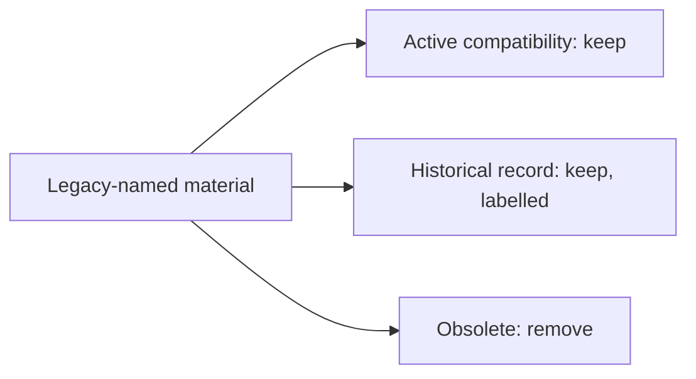

# Legacy perspective material — classification

This companion to the [Purpose acceptance review](02.14-review-purpose-acceptance.md) classifies material that still names the retired Intended / Current / Planned structure. It removes nothing on terminology alone, and review receipts and provenance are preserved.

| Item | Class | Disposition |
| --- | --- | --- |
| `cli_project.STAGE_NOTE` and the `cli_status` scaffold text | Active and required | Recognize earlier Context scaffolds as empty; never written to new clients |
| `purpose_review` legacy criteria and supplement names | Active and required | Validate existing histories; no longer generated |
| `cli_ownership` `.gitkeep` marker exception | Active, owner-only | Lets Admin target retired markers; remove in a separate checker change once none remain |
| `00-governance/docs/namespace-migration.md` | Historical and retained | Banner added; describes the retained migration runtime |
| `00-governance/docs/baseline-capture.md` and `baseline-*` companions | Historical and retained | Banner on the contract; companions link to it |
| `00-governance/src/` and `00-governance/tests/` | Historical and retained | Outside the package; its README already says so |
| `00-governance/types/document-reviews.json` and `docs/migration/` | Historical and retained | Receipts and provenance unchanged; new receipts only appended |
| `scripts/lib/cli_model.PERSPECTIVES` | Obsolete and removable | Removed; no shipped code used it |
| `00-governance/current/`, `intended/`, `planned/` placeholders | Obsolete and removable | Approved for deletion; deleted by Pablo after Admin was refused a repository-wide delete grant |

The historical suite imports its own `00-governance/src/cli_model.py`, so removing the shipped constant leaves it unchanged. Its 134 pre-existing errors are identical before and after.
