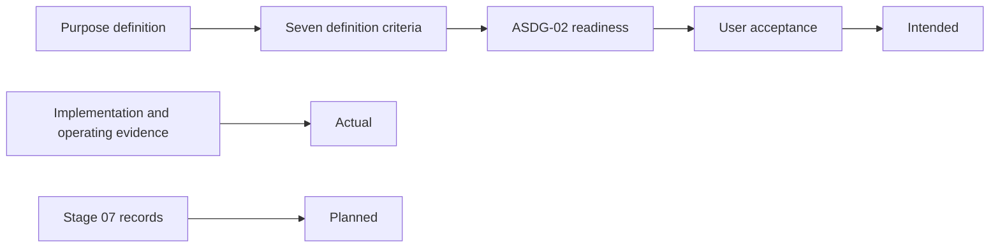

# Purpose acceptance and derived views — owner review

Pablo authorized this change under ASDG Admin (Focus: Final Documentation Model Consistency; Attitude: Black) at `eb8b3a7e6144192a2aff8fc5f31e7f90829382b9`. His decision: engineering artifacts are authoritative in their disciplines; Intended / Actual / Planned are derived assessment views, not content categories or storage. Purpose must be acceptable when no implementation or plan exists. The untracked `docs/asdg/00-governance/` was preserved.

## Applied by Admin

Each target passed `check-write` with `workflow: admin`. [Completion](../../../02-purpose/types/completion.md) replaces `current_evidence` and `next_improvement` with `coherence`, so the criteria judge rationale, outcomes, scope, coherence, acceptance questions, visual and documentation. The [contract](../../../02-purpose/types/contract.md) makes evidence and Stage 07 links optional and derives Actual and Planned elsewhere. [`purpose_review.py`](../../../scripts/lib/purpose_review.py) validates the new set and still accepts complete earlier eight-criterion histories. [Stage perspectives](../../../00-governance/docs/stage-perspectives.md), its map and snapshot template now call the views generated; Stage 07 stays the planning authority. Two historical documents gained banners, and the unused `PERSPECTIVES` constant was removed.

## Completed directly

The first version of this work stopped at targets the old checker reserved, and proposed an owner patch. After the [Admin authority correction](02.15-review-admin-authority.md), Admin applied the remaining changes itself, each target verified unchanged since HEAD. These cover the Purpose skill, the assessment line in all thirteen role entries, Purpose tests and the continuation fixture on one definition, a Purpose-only scenario test registered in `metadata/package-files.json`, and receipts. Admin could not delete the three approved Governance 00 placeholders: the desktop app grants deletion only for the whole repository, and Pablo declined that grant. Pablo then deleted them himself.

## Compatibility

Accepted Purpose baselines with eight-criterion events stay accepted while their bytes are unchanged. Validation cannot date an event, so the procedure, not the validator, keeps new readiness on seven criteria. Unchanged registrations of retired flat or nested supplements still hash and review. Legacy Context scaffolds are still recognized as empty Context.

Open limitation: events record criteria but not their contract, so a new review with the eight legacy keys would still validate. Proposed fix, not yet authorized: new readiness carries `criteria_version: 2` with exactly seven criteria; an unversioned event must carry exactly the eight legacy criteria; anything else fails. Status would report the contract of the latest readiness.

## Verification

Automated, Linux VM, Python 3.10, in the owner's checkout: portable 174 run, 3 skipped, no failures (HEAD: 164). The scenario test shows a lone accepted definition reaching ACCEPTED, Stages 03–12 without evidence, Stage 07 MISSING and no retired folder. A test-authored report section with Actual and Planned unknown passes the packet checker; no live worker derivation was observed.

See the [legacy classification](02.14-review-legacy-classification.md) and the [JSON record](02.14-review-purpose-acceptance.json). Human review is pending.
