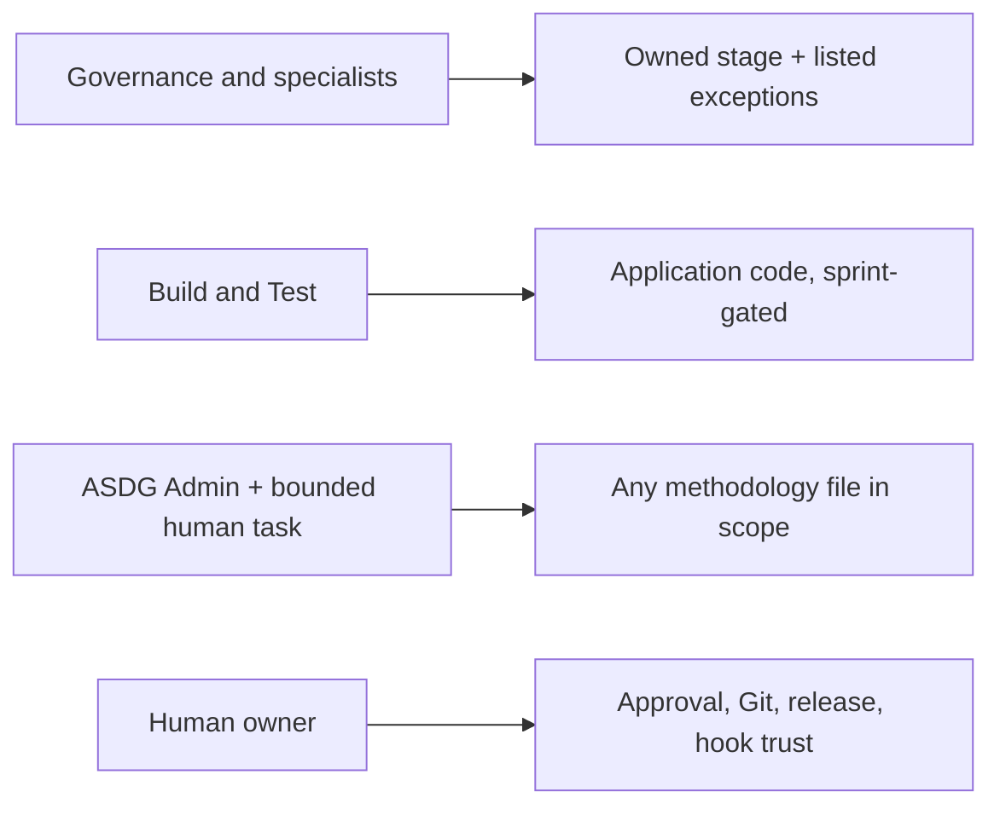

# ASDG Admin as an authority class — owner review

Pablo authorized this foundational correction under ASDG Admin (Focus: Foundational Admin Authorization Redesign; Attitude: Black) on the working tree of `eb8b3a7e6144192a2aff8fc5f31e7f90829382b9`. Decision: Admin must be able to maintain ASDG, but never approve its own work or override the owner.

## Root cause

The [checker](../../../scripts/lib/cli_ownership.py) modelled Admin as exceptions to specialist ownership. Admin reached only listed prefixes (`scripts/`, stage Markdown, `02.*` records). The protected-name rule (`AGENTS.md`, `SKILL.md`), the reserved ledger, `tests/`, `metadata/` and the checker's self-reservation still applied to it, so one authorized change split into Admin edits and an owner patch. The list also let Admin write a client's application `README.md`.

## New model

[Write controls](../../../00-governance/docs/write-controls.md#four-authority-classes) define four authority classes. An exact target declared with `workflow: admin` is decided first by `admin_refusal`, by scope alone. Standalone source: any file once `standalone_source` verifies the Git root, canonical origin and distribution identity, independent of where the checker runs. Client: the `asdg/` copy, root `AGENTS.md` and Admin's `02.*` records. Always refused: Git metadata, directories, symlinked or multi-link targets, nested repositories and, in the source, the consumer `asdg/` layout.

## Unchanged boundaries

Specialists, Governance and Build and Test keep their rules; other roles stay blocked from the checker and the source stage namespace. The Codex guard still denies arbitrary shell, so `git add`, `commit` and `push` stay human. The checker cannot verify a human's authorization; only a session-bound launcher context is outside the agent's control. Otherwise authority rests on explicit selection, the recorded request, the owner's review of the unstaged diff and platform permissions. In this session the desktop app's delete prompt applied to the whole repository, so Pablo deleted the three approved placeholders himself.

## Changed

Checker and companion; write controls, exceptions and documentation authority; Admin entry, contract and procedure (direct application, no owner-patch step). Six ownership tests replace the exception-list tests, and the provider receipt test now expects Admin to maintain the ledger.

## Verification

Automated, Linux VM, Python 3.10, your checkout: portable 174 run, 3 skipped, no failures; ownership 14 run, 1 skipped (OpenSpec CLI absent). Against the old checker, the new tests fail 4 cases. Provider: 10 run with the copytree error HEAD also shows here. Historical suite: same 134 errors as HEAD. Structure check passes; the refreshed manifest's integrity result is in the [JSON record](02.15-review-admin-authority.json). Human review is pending.
