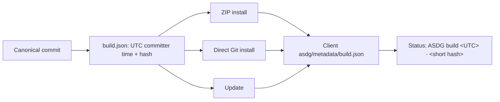

# Commit-based build identity — owner review

Pablo requested this change under ASDG Admin on branch `build-identity`, starting from `fbea1f96166f5ca42eef0549f4092aa234f9b90e`. Decision: nobody increments a pilot number to tell builds apart; a build is named by the canonical commit it came from.

## What changed

[Build identity](../../../scripts/lib/build_identity.py) derives the record from the commit's committer timestamp in UTC and its hash: full hash stored, seven characters displayed. Build time never enters it, so rebuilding a commit reproduces the identifier and ZIP bytes.
A build is attributed only when every selected file equals that commit's blob. Unmatched bytes build an unattributed ZIP; an explicit unmatched `--commit` fails.
ZIP, clone install and update write the client's own `asdg/metadata/build.json`; installs also keep it as `installation_source.build` in `.asdg/project.json`. Status reads only that record, so client commits never change it.
The record cannot be a package-list member or a synchronized methodology file. Named release labels in `metadata/distribution.json` and `cli_model.py` are unchanged for deliberate releases.

## Update after a fresh install

A fresh `init` left `update` without a baseline, so updating Alice's copy produced 22 conflicts. [`installed_baseline`](../../../scripts/lib/cli_sync_manifest.py) now reads the commit named by `build.json` or the binding's `installation_source.commit` from canonical history and uses it only when the package snapshot equals the recorded one. The same rehearsal now has no conflicts.

## Compatibility

Installs without a record, including existing `0.3.0-pilot.4` clients, show `ASDG <release> · <commit> (build time not recorded)` or `(build not recorded)`. A local methodology edit shows `(local methodology changes)`; an invalid record is reported, not trusted.

## Verification

Automated checks on the final tree are in the [JSON record](02.16-review-build-identity.json): the integrity check and the full portable suite, including seven new build identity tests and one new upgrade test.
Disposable rehearsals used a pinned-commit install and an update of a copy of Alice; no real client was changed. The dashboard does not yet show the build line. Human review is pending; tests passing is not approval.
