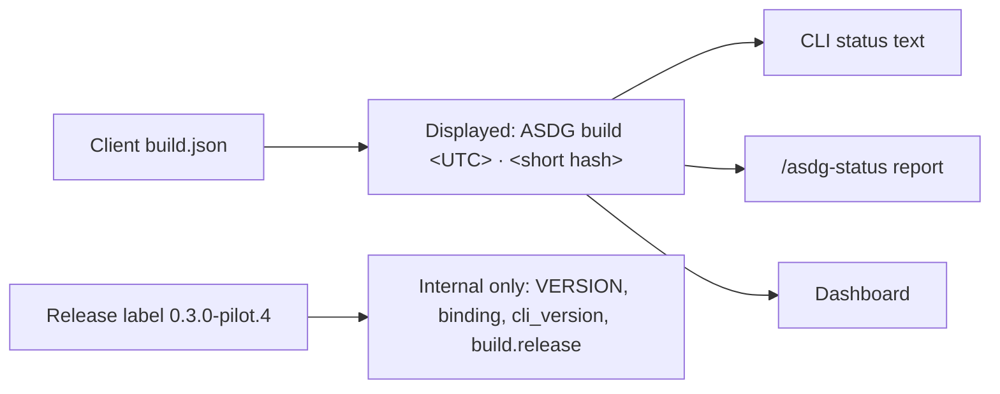

# Build line as the displayed ASDG version — owner review

Pablo requested this change under ASDG Admin on branch `status-build-version`, starting from `1154edf1e53e48ced53b8dbe37a30456b10cfb7f`. Decision: status views show the automatic build timestamp and commit hash as the ASDG version, and no longer show `Release label: 0.3.0-pilot.4`.

## What changed

[`render_status`](../../../scripts/lib/cli_status.py) no longer prints the release label; its third line is the build line. The [status report format](../../../skills/asdg-status/status-format.md) tells `/asdg-status` to treat the build line as the version and omit the label.
The [dashboard](../../../scripts/lib/cli_dashboard.py) replaces its "CLI version" row with the build line, closing the gap noted in [02.16](02.16-review-build-identity.md).
Installs without a build record now display `ASDG build not recorded`, with the binding commit when still valid, instead of a pilot label.

## Preserved

`VERSION`, `metadata/distribution.json`, the binding's `distribution_version`, status JSON `cli_version` and `distribution_version`, and `build.release` are unchanged. Compatibility checks between a client and its distribution still use them, so existing `0.3.0-pilot.4` installations keep working. `asdg --version` and installer previews still name the release; they are not status views.

## Verification

Automated checks on the final tree are in the [JSON record](02.17-review-build-as-version.json). A disposable copy of Alice is updated from a disposable commit of this tree before any real update. Human review is pending; tests passing is not approval.
