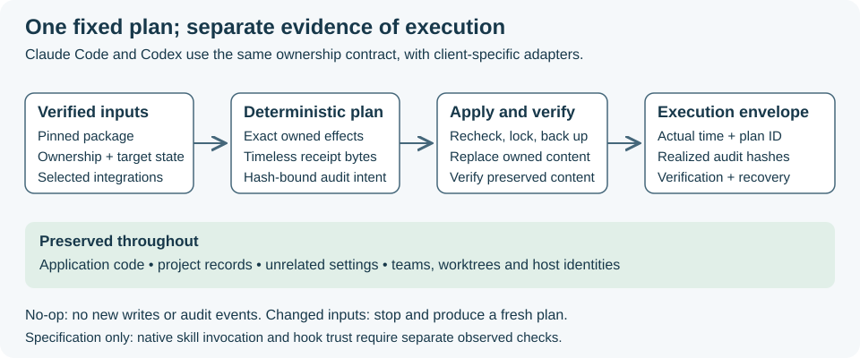

# Plan identity and execution evidence

A replacement must be reproducible without inventing a time of execution. The operation plan describes approved effects; the execution envelope records when those effects actually occurred. The [catalog](02.25-push-replace-catalog.json) and [ownership schema](02.25-push-replace-ownership.schema.json) define their boundaries.

## Deterministic planning

Canonical JSON encoding uses UTF-8, sorted object keys, compact separators, no NaN/infinity, and one defined newline policy. Ordered hook arrays retain their semantic order; independent path inventories sort by normalized relative path and selector. Duplicate JSON keys are invalid, not silently collapsed.

Before constructing a new basis or receipt, compare the desired installed content, source/catalog/generator identities, client selection and exact ownership entries against the current verified receipt. Exclude transaction provenance (`plan_basis_sha256`) from this material comparison. If they match and no owned file needs repair, reuse the existing receipt byte-for-byte and return a no-op without calculating a successor receipt. A source identity or ownership change is a material delta even when payload bytes match.

The operation basis binds schema versions, source repository and snapshot hashes, generator/catalog hashes, resolved target root and repository identity, selected clients, prior receipt hash and all resolved mutations with before-hashes. It excludes the new ownership receipt and execution-only intents/envelopes to avoid circular hashes.

`plan_basis_sha256` hashes this basis. The new ownership receipt contains that basis digest and exact installed entity hashes, and contains no final plan ID or clock value. Its exact output bytes and after-hash can therefore become a mutation in the final plan without referring to themselves.

The final plan token hashes the basis plus the resulting ownership-receipt mutation and typed execution intents. A change to any dependency, including generator bytes or existing audit-history bytes, invalidates the token. Source or target changes after preflight cause apply to stop; they never silently generate a new authorized plan.

## Timestamped audit events

An `append-review-events` intent binds the exact ledger path, before-hash, prior event sequence, fixed event fields and permitted runtime fields. Fixed fields include each changed document path, before/after hashes, actor, generator and the declaration that no human approval is inferred. The only runtime fields are the actual execution timestamp and final plan ID.

Do not put the future ledger’s full after-hash into the deterministic preview: its timestamp does not exist yet. Instead hash the exact event templates and the intent schema. The executor must preserve the old events exactly and add only the authorized events with those runtime fields.

After verification, the execution envelope records the final plan ID, actual UTC time, realized ledger after-hash, changed-file hashes, backup/journal locations and verification results. That envelope is append-only evidence, not an input to the same plan or a claim that the native clients ran successfully.

A no-op writes neither receipt nor envelope nor review events. A completed plan cannot replay audit appends. Preview must hash the unchanged ledger dependency so an intervening review event invalidates an older preview.

## Safe application and failure boundaries

Preflight source integrity, ownership evidence, target compatibility, path types, parsers, backup capacity and write permissions before any client mutation. Refuse symlinks, multi-link files and nested repository targets; do not traverse worktrees or Git metadata as replacement content.

Acquire the target replacement lock before the final input comparison. Persist an exact backup and durable journal before applying changes. The implementation must define recovery states and coordinate receipt/envelope publication with verified completion; an incomplete run cannot be reported as synchronized.

Rollback must not overwrite a concurrent user edit. Report intervention when restoration no longer matches the recorded transaction state. A cooperative lock protects cooperating tools only; it is not protection from arbitrary external writers.

These are implementation requirements, not guarantees of the current `cli_files.apply` helper. Its rollback covers ordinary exceptions only. Recovery, concurrent-writer behavior and interruption between each mutation and receipt publication require executable acceptance tests before the replacement command is released.

## Cross-client acceptance cases

Test the same pinned inputs under different clocks: operation basis, output ownership bytes and final plan token must match. Applying later may change only permitted audit-envelope fields and their realized hashes. Changing a source, target, selector, client choice or ledger invalidates the plan.

Codex tests must accept preserved unrelated TOML settings and hook entries, and reject missing, altered or duplicate required entries. Claude tests must prove removal of retired adapters while retaining unknown neighbor files. Each client’s unselected integration stays byte-identical.

Document the Python interpreter and parser used. Test Python 3.9/3.10 parser behavior separately from Python 3.11+ `tomllib`. Tests in disposable repositories establish file behavior; native invocation, sessions and hook trust require separate observed evidence in Claude Code and Codex.
