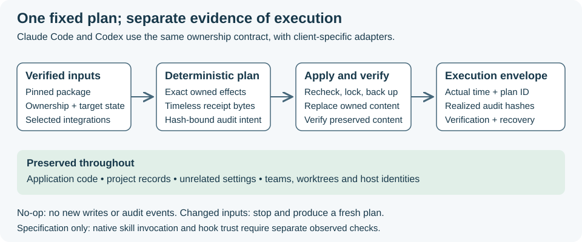

# Deterministic ASDG push replace

Pablo wants one explicit operation that adopts a selected canonical package and regenerates the client’s ASDG integrations. The proposed script owns file behavior; a future skill can explain its plans. This specification covers Claude Code and Codex, with the selected integrations retained per client.

The [typed ownership catalog](02.25-push-replace-catalog.json) defines scope and per-entity actions. The [ownership receipt schema](02.25-push-replace-ownership.schema.json) defines the proposed client record at `.asdg/installation-ownership.json`. These are specifications, not an installed push-replace command.

## Contract

1. Read the explicit source package, verified target identity, selected integrations and validated prior ownership evidence. No network lookup selects “latest.”
2. Resolve exact files, blocks, keys and hook entries. Unknown content stays untouched and is reported; an incoming path colliding with unknown content blocks apply.
3. Produce a sorted plan with before-hashes, exact proposed file bytes/after-hashes, proven obsolete entries, preserved entities and conflicts. Audit appends use the separate execution-intent rules below.
4. Bind source bytes, generator and catalog hashes, target identity, client selection, prior ownership evidence, and relevant target values. Recheck the same inputs under the apply lock before writing.
5. Back up the planned changes, apply them, and verify both the owned result and preservation of unrelated content. Record installed ownership only for a verified result.
6. Repeat preview after success: no file writes, new backups or audit events. A timestamp cannot turn a no-op into work.

## Ownership and first adoption

The catalog contains typed categories and resolvers; only a resolved, validated inventory contains write targets. Pattern-looking names never grant deletion authority. Unknown schema versions, overlapping ownership, unsafe paths and ambiguous managed blocks fail closed.

Existing installations do not yet have the proposed receipt. First adoption resolves candidate ownership from the known source/installation evidence and presents an exact inventory for review. Missing evidence never becomes blanket authority over `.agents/`, `.claude/`, `.codex/` or `asdg/`.

New incoming owned files may be created when absent. Existing unproven files block replacement. Previously owned, now-obsolete adapter files are removed symmetrically for Claude and Codex. User changes to a proven owned whole file are included in the backup and explicitly shown as overwritten.

Project documents, lifecycle state, team write receipts, Git-common-directory run records, existing worktrees, host identities and unrelated settings survive. First installation, incompatible state migration, OpenSpec setup, native team creation and hook trust are separate operations.

## Verification for both clients

Whole-file adapters and mod runtime files require exact canonical bytes. Shared files require ownership-aware writing **and verification**: unrelated values may remain without producing a false damaged result. Compare their preserved content before and after apply.

For Codex, validate the required `features.hooks` boolean and exact ASDG hook registrations, including event, matcher and all behavioral fields; preserve unrelated keys/entries. Duplicate or ambiguous definitions block apply. Required feature configuration does not establish hook trust or exclusive ownership of a preexisting user setting.

For Claude, render adapters from shared templates, reconcile the optional managed AGENTS import without replacing project prose, and verify every owned mod file. Removing a retired Claude skill removes only its proven owned files. No Claude enforcement guard is implied by a status mod.

The current initializer and verifier do not implement these shared-file semantics; they retain their existing conservative behavior until separately changed and tested. Python 3.9+ remains the package contract. A portable TOML parser or an explicit unsupported-runtime preflight is required; the flat agent-config fallback cannot parse general client configuration.

## Determinism and delivery

The [plan and execution protocol](02.25-push-replace-protocol.md) separates the timeless ownership payload, hash-bound operation basis, final plan token and timestamped execution envelope. The receipt schema forbids timestamps in the ownership payload. Audit after-hashes are recorded after execution, never falsely promised as fixed preview bytes.

Proposed interface: `push-replace --source <canonical> --target <client> --dry-run --json`, then `--apply --plan <digest>`. This command, transactional recovery and installation-ownership persistence still require implementation; no existing command gains overwrite behavior from this document.

Acceptance must cover both clients and client isolation, shared settings surviving and verifying, retired adapters removed, unknown content retained, stale plans rejected, backup/restore and interrupted-apply recovery, malformed schemas/paths blocked, clock-independent previews and a no-op second run. Report native invocation and trust separately from filesystem verification.

The [source-only contract tests](../../../tests/test_push_replace_contract.md) validate catalog consistency and ownership receipt shape for both clients. They do not execute the proposed replacement protocol. Exact results and remaining limits are recorded in [the review receipt](02.25-push-replace-review.json).
