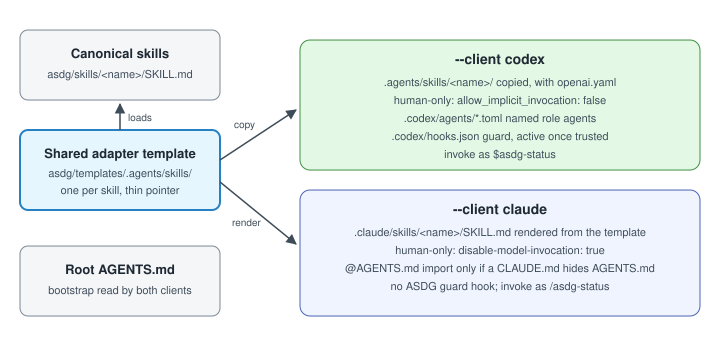

# Codex, Claude or both: one methodology, thin client integrations

ASDG behaves the same in Codex and Claude Code. Governance, roles and skills live once under `asdg/`; each client gets only thin native adapters that load those canonical files.
A project installs only the integrations its developers choose and can add the other later. This page is the authoritative compatibility contract.

## Choose the clients

Run the local initializer from the project root; a machine-wide `asdg` command may resolve an older installation.

| Command | Result |
| --- | --- |
| `python3 asdg/scripts/init.py` | Preview setup for the recorded clients; Codex when none is recorded, as before |
| `python3 asdg/scripts/init.py --client codex` | Preview adding Codex |
| `python3 asdg/scripts/init.py --client claude` | Preview adding Claude |
| `python3 asdg/scripts/init.py --client both` | Preview adding both |

`python3 asdg/scripts/cli.py init` takes the same options, including `--dry-run`; an unknown client is rejected before any write.
Apply only after explicit review with `--apply --plan TOKEN_FROM_PREVIEW`; [both acquisition paths](installation.md) use this engine.
Both clients use the [Init approval presentation](../skills/asdg-init/SKILL.md#mandatory-approval-presentation--both-clients) in ordinary text; no graphical approval button is required. Plan approval never grants hook trust.
Selection is additive: adding one client never removes or rewrites the other's files. `.asdg/integrations.json` records each selected client and how it was recorded.

## What each client gets

| | Codex | Claude Code |
| --- | --- | --- |
| Instructions | Root `AGENTS.md` | Root `AGENTS.md`, read natively from Claude Code 2.1.277 |
| Skills | `.agents/skills/<name>/` with `agents/openai.yaml` | `.claude/skills/<name>/SKILL.md` |
| Invoking a skill | `$asdg-status` | `/asdg-status` |
| Human-only skills | `allow_implicit_invocation: false` | `disable-model-invocation: true` |
| Named role agents | `.codex/agents/*.toml` | None |
| Guard and activity hooks | `.codex/hooks.json`, active once trusted | None installed |

Each template in `asdg/templates/.agents/skills/` is the single source for both adapters: setup copies it for Codex and renders the Claude adapter from the same name, description and body.
A skill whose Codex policy forbids implicit invocation gets `disable-model-invocation: true` in Claude; today that is Admin, Focus, Init, Status, Report Project Status and Documentation. Codex metadata never controls Claude.

## Claude and AGENTS.md

Claude Code skips its native `AGENTS.md` read when a `CLAUDE.md`, `.claude/CLAUDE.md` or `CLAUDE.local.md` exists in the project or any parent folder.
Only then does setup add a minimal managed `@AGENTS.md` import: at the top of the existing `CLAUDE.md` or `.claude/CLAUDE.md`, otherwise in a new `CLAUDE.md` holding just that import. An existing import is never duplicated.
Versions before 2.1.277 need the same import, added by hand. Check loaded files with `/memory` or `/context`. There is no separate Claude policy.

## Repeat setup and verification

Repeat setup creates nothing that already exists: identical files are skipped; differing files and edited managed blocks are conflicts; no entry, import or receipt is duplicated.
`verify` always checks the shared package, then each client: `NOT_SELECTED`, `COMPLETE` or `DAMAGED`, with runtime behavior `NOT_VERIFIED`.
An installation made before client tracking reports Codex as `legacy-unrecorded`; the next setup records it explicitly and says so.

## Enforcement differences

Both clients follow [role ownership and preflight](../00-governance/docs/write-controls.md). Codex adds deterministic patch checks only with trusted hooks and session-bound role context; no context denies writes. Claude gets no ASDG guard. No native role bridge is installed.
Titles sync through Codex thread-title tools or the Claude desktop session-title tool; the Claude CLI has neither, so titles are reported, not set.
Initialization automatically invokes [canonical team setup](../skills/asdg-create-team/initialization.md) after the complete plan’s APPROVE.
Codex team readiness means thirteen verified project chats: Governance and stages 01–12, each activated with NoFocus/NoAttitude; existing confirmed chats are reused and preserved. Admin is excluded.
Claude team readiness means all thirteen canonical role sources and generated skill adapters verified, with Governance loaded as the default in a new target project chat. Manual `/asdg-focus` selects specialists; ASDG has no automatic Claude chat API.
For both integrations, each readiness condition applies. Native tools missing in Codex block full readiness; installed files alone are insufficient.
The shared sidebar sorting preference still requires separate approval. Ordering limitations do not change role availability.
Native discovery must be observed in each client; one client's result says nothing about the other. Development view reports missing Codex capabilities.
