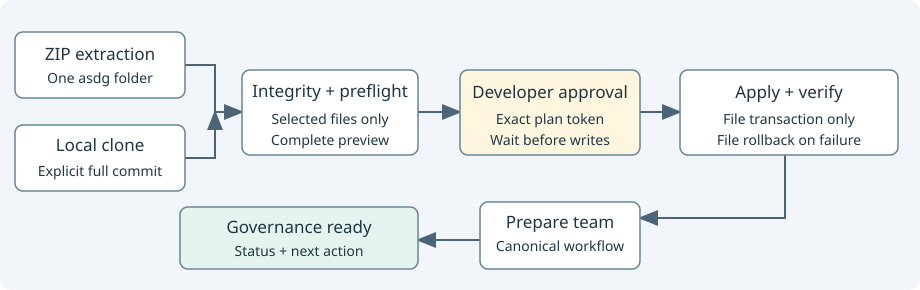

# Install ASDG and prepare its project team

ASDG initialization installs the methodology and prepares the project’s ASDG team.

The recommended [repository-URL Quick Start](https://github.com/Elustondo-ai/asdg#quick-start--give-your-agent-the-repository-url) lets the agent acquire the ZIP safely. Manual ZIP + Prompt and Clone + Prompt remain alternatives using one Python 3.9+ engine on macOS/Linux. The prompts select inputs, show the plan and wait for approval; they never implement a second installer.



## Acquire and preview

ZIP: extract into an existing Git root so it contains `asdg/scripts/init.py`. Inspect the archive first; never extract over an existing `asdg/` folder or application files. The engine checks extracted bytes; it cannot undo an earlier extraction overwrite.
Clone: use an existing local clone of the canonical repository and an explicitly selected full commit. The engine checks origin, HEAD and every selected file against that commit. Unselected provider work is not copied.
Run the selected package's own entry point; no global command, download, dependency installation or startup-file change is needed.

```sh
# ZIP: from the target Git project
python3 asdg/scripts/init.py --client codex --dry-run
# Clone: substitute explicit paths and the reviewed full commit
python3 /path/to/canonical/scripts/init.py --source /path/to/canonical --commit FULL_COMMIT --target /path/to/project --client claude --dry-run
```

Choose `codex` or `claude`; `both` requires an explicit choice. Supply an initial `--project-status defining` only when that declaration is intended; otherwise first setup records `new`.
No `--apply` means preview. Every selected methodology path, generated change/diff and canonical team requirement is shown; source/target files are unchanged. Temporary normalized package files are removed afterward.
A matching manifest establishes package integrity, not release approval. A stale manifest or dirty selected clone file blocks installation; do not refresh it as an installation shortcut.

## Approve, apply and verify

The [canonical Init skill](../skills/asdg-init/SKILL.md#mandatory-approval-presentation--both-clients) owns the mandatory text approval summary, actual preview field/count mapping, accessible complete-plan reference and APPROVE/CANCEL responses for both clients. The install request itself is not plan approval.
After that approval, repeat the same command/options, replacing `--dry-run` with `--apply --plan TOKEN_FROM_PREVIEW`. The token binds the source, target, client and planned bytes; a changed plan requires fresh review.
The engine uses existing collision protection and rollback, then checks the installed package and selected integrations before completing. A failed verification rolls back its own writes. It is not crash-safe against power loss or hostile concurrent writers.
Run `python3 asdg/scripts/cli.py verify --json` in the target, and repeat the preview to confirm no further writes. No Git mutation occurs.
The [canonical Create team workflow](../skills/asdg-create-team/initialization.md) prepares native inventory before preview; `--team-inventory PATH` binds Codex create/reuse effects to the same plan token. APPROVE covers those displayed effects without a second team question.
After verified file installation, Init executes that workflow, confirms team readiness and reports Status from Governance. Native actions are outside file rollback; partial success is retained and rediscovered before retry.
A plain Python invocation cannot operate native chats: it reports file installation complete and initialization pending. The canonical agent workflow completes the client phase automatically. Missing tools or ambiguous inventory prevent a readiness claim.
Claude prepares role/skill sources and adapters with Governance available by default; specialists use manual Focus. Codex prepares thirteen activated project chats. Admin is excluded. See [client readiness](client-integrations.md).

| Location | Ownership and protection |
| --- | --- |
| `asdg/` | Only selected portable methodology; `.git`, provider extras, source `docs/asdg/` and source `.asdg/` are never copied |
| `.asdg/` | Target binding/provenance, inactive initial sprint, lifecycle, integration selection and append-only document receipts; existing state preserved |
| `.agents/`, `.codex/` | Selected Codex adapters/configuration/hooks; collisions block, trust is separate |
| `.claude/skills/` | Selected Claude adapters; existing files preserved or reported as conflicts |
| `AGENTS.md`, optional `CLAUDE.md`, `.gitignore` | Managed integration plus preserved project text; instruction changes appear in preview, with instruction backups |
| `docs/asdg/`, `logs/` | Missing generic stage introductions and log marker only; authored project content preserved |

Existing incompatible versions, edited adapters or legacy linked installations require explicit repair/upgrade. Initialization does not reconcile them or grant lifecycle acceptance.
Ordinary status/verify remains available for local methodology modifications; new installation requires package integrity.

## Human client tests

Use the copy-ready [ZIP prompt](install-zip-prompt.md) or [Clone prompt](install-clone-prompt.md) in Claude Code or Codex. Check native skills and a harmless invocation in a disposable project after setup.
Review [client integrations](client-integrations.md) and [native limits](native-integration.md); generated adapters/hooks do not prove runtime enforcement. Only the human/native flow grants hook trust.
Only displayed team setup and initial activation are included. Context analysis, commits, pushes, releases, publication and sprint starts remain separate decisions.
