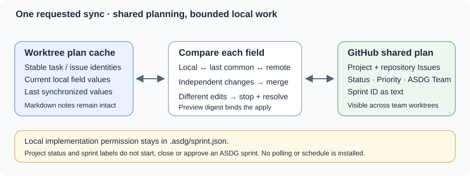

# Share a project plan across worktrees

Developers and ASDG teams use Project Plan Sync to reconcile a structured local plan with GitHub Issues and one shared GitHub Project. Existing planning documents remain readable source material; the cache supplies stable identities and field values the sync can compare deterministically.



*Workflow illustration; it is not a GitHub interface screenshot or evidence of a live sync.*

## On-demand workflow

Invoke [`$asdg-project-plan-sync`](../skills/asdg-project-plan-sync/SKILL.md) in Codex or `/asdg-project-plan-sync` in Claude Code. One explicit request authorizes the required Project, field and Issue writes for that sync. There is no background schedule, polling loop or hook.
From the client root, preview with `python3 asdg/scripts/cli.py project-plan-sync --dry-run --json`; inspect changes and apply the returned digest with `--apply --plan <digest> --json` instead of `--dry-run`.
Optional `--repo owner/repo` and `--project-number N` select the target. Without an existing cache, `--bootstrap-ref dev` reads a structured cache from that Git ref; it neither switches branches nor makes `dev` the winner. Use identical options for preview and apply.
Without a recorded Project number, a unique exact Project title is reused or a missing one is created; ambiguous matches block. Imports cover open and closed repository Issues, excluding pull requests. The preview exposes membership additions; other-repository Project items stay untouched.
The command uses existing `GH_TOKEN`, `GITHUB_TOKEN`, or authenticated `gh`. It reports missing credentials or resource permissions; it never creates credentials. Treat the Issue body as shared content. Local-only notes and sources are excluded from API synchronization, but ordinary Git commits can still share the versioned cache; keep secrets out of it.

## Prepare the first structured plan

The cache lives at `docs/asdg/07-planning/project-plan-cache.json`. Inspect existing planning documents and a read-only remote Issue inventory first. If neither this file nor the requested ref supplies a cache, prepare it from that evidence, preserving source documents and historical task labels. Material identity or interpretation conflicts need the user's decision; the engine never parses prose into Issues automatically.
The dry-run JSON's `cache_preview` exposes remote imports before any writes. Matching titles do not establish the same task. For a verified existing Issue, seed its observed preview entry, then edit intended fields. An unmarked Issue #7 uses `github:7`; retain its old document label in local notes/source references. Using a fresh ID for an existing Issue would create a duplicate. Never invent a synchronized `base`.
This complete one-item example starts a genuinely new remote Issue:

```json
{
  "schema_version": 1,
  "repository": "example/client",
  "project": {"owner": "example", "number": null, "title": "ASDG Plan — example/client"},
  "items": [{
    "id": "PLAN-001", "issue_number": null,
    "fields": {"title": "Explain the welcome screen", "body": "Document the agreed entry flow.",
      "state": "OPEN", "status": "Todo", "priority": "High", "team": "Atlas", "sprint": "SPRINT-001"},
    "base": null, "notes": "Working notes stay local.",
    "sources": ["docs/asdg/07-planning/03-plan.md"]
  }]
}
```

Each item has an immutable `id`, optional remote `issue_number`, all seven string-valued `fields`, a `base`, local `notes` and local `sources`. State is `OPEN` or `CLOSED`; use empty strings for unspecified project fields. New items have `base: null`; the command records the last verified synchronized fields there. Imported Issue IDs use `github:<number>`.

## Resolve differences without losing work

For every field, compare current local and remote values with `base`. One-sided edits propagate; equal edits converge; different changes on both sides stop before writes. There is no preferred branch and no deletion synchronization. `notes` and `sources` remain local and are never sent to GitHub.
Issue title, body and state synchronize with Project `Status` plus newly created text fields `ASDG Priority`, `ASDG Team` and `ASDG Sprint`. Existing compatible select fields are retained; an existing Sprint iteration field accepts only an exact unique title. This version creates no iteration calendar or sprint lifecycle transition. Team text names an ASDG team, not a GitHub account; Status must match the Project's choices.
Apply checks its preview again. If interrupted, `--resume --json` uses the recorded scope, without plan/bootstrap/Project selection arguments, and requires remote readback. An uncertain non-idempotent create is reported for reconciliation rather than blindly repeated. The ignored journal and lock live under `.asdg/cache/project-plan-sync/`; do not edit them manually.
If cache edits or conflicts require a new plan, `--abandon --plan <original-digest> --json` archives the unfinished attempt and preserves all local edits and partial remote results. Unresolved uncertain writes block abandonment. Reconcile the intended values, then preview again; abandonment does not undo GitHub actions.
An explicit human decision may permit `--acknowledge-uncertain` with abandonment after an unresolved outcome. The agent must explain possible existing remote creation and duplicate risk, and must never supply this flag autonomously. It preserves evidence without verifying or repeating the uncertain action.
After success, inspect returned Project/Issue links and the updated cache; a fresh no-change preview checks convergence. Base values advance only after verified remote results. GitHub status never grants implementation scope, starts/closes `.asdg/sprint.json`, or proves acceptance. Sync performs no Git commit, push, branch switch or approval.
