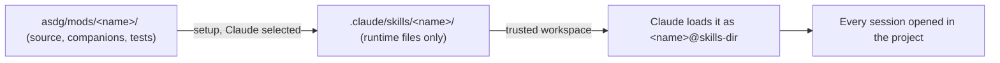

# Claude mods shipped with ASDG

A mod changes Claude's own interface: a row above the prompt, a pane beside the chat, a command. ASDG ships its mods here and setup installs them into each project that selected Claude.
Codex has no equivalent surface, so a Codex-only project gets nothing from this folder.

## Mods

| Mod | What the user sees | Reads |
| --- | --- | --- |
| [asdg-sprint-status](asdg-sprint-status/hooks/register.md) | The sprint, branch and objective above the prompt; scope and acceptance criteria in a pane | `.asdg/sprint.json`, `.git/HEAD` |

## How a mod is installed

[`cli_clients`](../scripts/lib/cli_clients.md) treats every folder here that holds `.claude-plugin/plugin.json` as a mod.
Setup copies exactly four runtime files, unchanged, to `.claude/skills/<name>/`: the manifest, `hooks/hooks.json`, `hooks/register.tsx` and `types/index.d.ts`.
Companions and tests stay in the distribution. The manifest's `name` must equal the folder name, and a mod may not share a name with a skill.
Installed files are managed like skill adapters: `verify` reports a missing or edited one as `DAMAGED`, and setup never overwrites a differing file.

## Limits

Claude loads a project mod only in a workspace the person has trusted, and may need `/reload-plugins` or a new session to pick it up. Setup proves the files are in place, not that Claude drew anything.
The mod API is early access and changes between Claude Code releases; re-validate after an upgrade.
A mod runs with the session's access to the project. Keep each one read-only unless a change record says otherwise.

## Changing or adding a mod

Edit the source here under [ASDG Admin](../admin/AGENTS.md), never the installed copy. Add every new file to `metadata/package-files.json`.
Check it with `claude plugin validate asdg/mods/<name>` and `claude plugin test asdg/mods/<name>`, then run [the setup tests](../tests/test_claude_mods.md).
