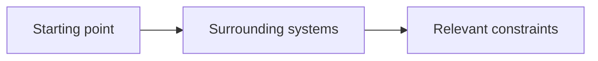

# Context

Understand the environment the project must fit into: people, existing systems, vocabulary, constraints and integrations.

## What belongs here

For a project from scratch, an empty context assessment may be appropriate after discussion. Existing projects and integrations need their relevant dependencies described. Initialization does not choose either situation.

## Project details

Project-specific details are not supplied by initialization. Existing evidence may be documented elsewhere; this introduction makes no claim about its presence or approval.

Describe the domain, constraints, dependencies and sources that shape the project.
