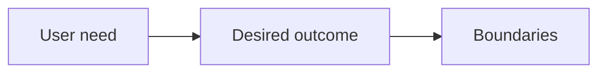

# Purpose

Explain why the project should exist, who benefits and what useful outcome it should achieve.

## What belongs here

Describe desired benefits, constraints and non-goals. A rough idea from setup is a starting point, not an accepted Purpose baseline.

## Project details

Project-specific details are not supplied by initialization. Existing evidence may be documented elsewhere; this introduction makes no claim about its presence or approval.

Explain who needs the system, why it matters and what outcomes would demonstrate value.
