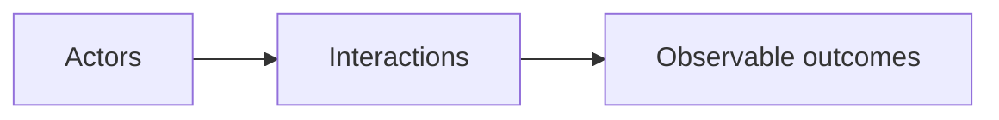

# Use Cases

Describe who interacts with the system, what happens and what each person should experience.

## What belongs here

Use concrete scenarios, system boundaries and important exceptions to make intended behavior discussable.

## Project details

Project-specific details are not supplied by initialization. Existing evidence may be documented elsewhere; this introduction makes no claim about its presence or approval.

Maintain the system model and illustrated use cases. Cite observations separately when describing implemented behavior.
