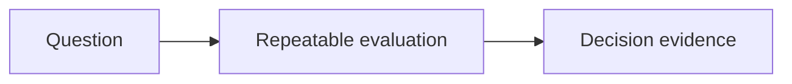

# Benchmarks

Decide what evidence would show that the product works and is useful.

## What belongs here

Describe representative cases, comparisons, success criteria and user validation. Distinguish proposed checks from observed results.

## Project details

Project-specific details are not supplied by initialization. Existing evidence may be documented elsewhere; this introduction makes no claim about its presence or approval.

Document reference alternatives, evaluation criteria and measured comparisons, including test conditions.
