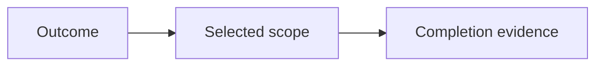

# Planning

Select a manageable piece of work and explain why it matters and how completion will be demonstrated.

## What belongs here

Connect release objectives and sprint tasks to dependencies, exclusions and acceptance criteria. Proposals do not authorize implementation.

## Project details

Project-specific details are not supplied by initialization. Existing evidence may be documented elsewhere; this introduction makes no claim about its presence or approval.

Integrate work items, progress, gaps, dependencies and priorities. Reference the specialist-owned artifacts and the current sprint decision.
