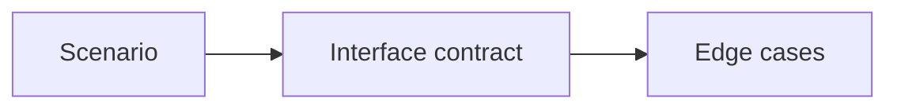

# Detailed Design

Make component behavior precise enough to implement and evaluate.

## What belongs here

Describe types, functions, inputs, outputs, collaborators, state changes and failure behavior.

## Project details

Project-specific details are not supplied by initialization. Existing evidence may be documented elsewhere; this introduction makes no claim about its presence or approval.

Define interfaces, component contracts, behavior and edge cases.
