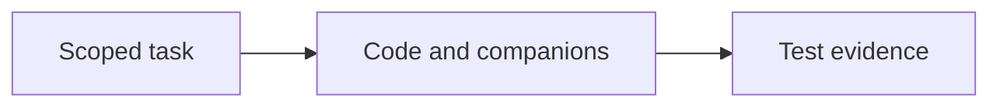

# Build and Test

Explain what an authorized code change delivers and what its tests demonstrate.

## What belongs here

Link implementation and source companions to meaningful checks. Record failures, limitations and behavior still requiring real-world validation.

## Project details

Project-specific details are not supplied by initialization. Existing evidence may be documented elsewhere; this introduction makes no claim about its presence or approval.

Link scoped changes to the tests run, their results and the revision tested.
