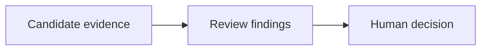

# Review and Release

Assess a candidate delivery using requirements, implementation, documentation and test evidence.

## What belongs here

Record readiness findings and unresolved issues. Review recommendations do not themselves approve a release.

## Project details

Project-specific details are not supplied by initialization. Existing evidence may be documented elsewhere; this introduction makes no claim about its presence or approval.

Record review findings, exact-state decisions and evidence of release.
