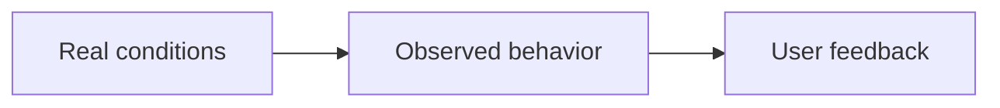

# Operations

Find out whether the system works in realistic environments and helps its users.

## What belongs here

Describe delivery, recovery, compatibility and user trials. Separate technical reliability from user acceptance.

## Project details

Project-specific details are not supplied by initialization. Existing evidence may be documented elsewhere; this introduction makes no claim about its presence or approval.

Document operating procedures, observed deployment conditions and acceptance evidence.
