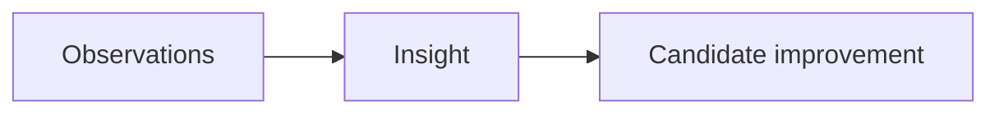

# Observability

Turn observations and feedback into supported lessons and candidate improvements.

## What belongs here

Record what happened, what it suggests and what remains uncertain. A small project may need only a short trial note; this folder does not require a telemetry platform.

## Project details

Project-specific details are not supplied by initialization. Existing evidence may be documented elsewhere; this introduction makes no claim about its presence or approval.

Link observations and feedback to measured signals, interpretations and lessons.
