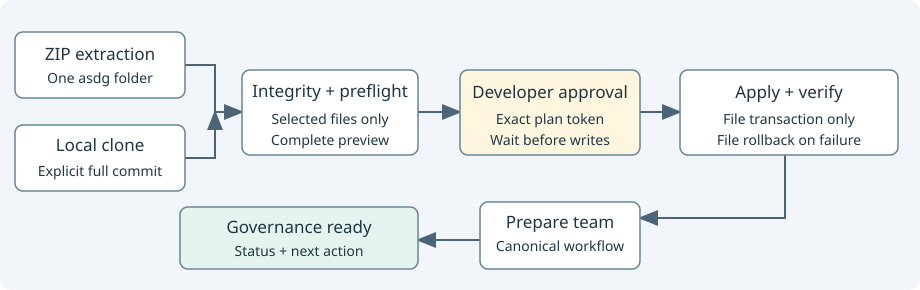

# Deterministic project installation

[Source](cli_install.py). One engine plans both extracted packages and verified local clones.

## Responsibility and collaborators

`cli_install_source` checks package hashes and clone identity; `cli_project` plans integrations and scaffolds; `cli_files` owns collision checks and rollback.
`cli_team` validates native inventory and derives the canonical workflow’s role effects for the approval digest; it never creates chats.
Both acquisition paths normalize only selected distribution members into a temporary directory so provider-only templates cannot enter generated integrations.

| Interface | Contract |
| --- | --- |
| `install(...)` | Defaults to preview. Accepts source/commit for a clone, target, client, initial status, apply_changes, expected_plan and optional team_inventory. Returns source identity, every distribution file, generated diffs, planned paths and verification results. |
| `render(report)` | Shows the full file/team plan or file completion with client work pending; it never runs Status or creates chats. |

The timestamp in the plan token freezes generated timestamps across preview and apply. Replanning hashes source bytes, target Git identity, destination bytes, client choice and initial status; changed inputs require another preview.
No plan file is written. Temporary normalization is removed after both preview and apply; target and source are unchanged during preview.
The token identifies reviewed bytes; it is not human authentication or methodology approval. Prompts must wait for explicit developer approval.
Missing approval tokens, collisions, stale manifests, mismatched commits and incompatible bindings fail before target writes. Verification runs inside the existing rollback boundary.
Integrity and structure are deterministic checks; native application discovery, invocation and hook trust remain unverified.
After file application, `installation_complete` describes files only; `initialization_complete` remains false in Python. The canonical Init skill continues the approved Create team workflow, validates actual receipts, then reports Governance Status. This avoids claiming native side effects from filesystem checks.
