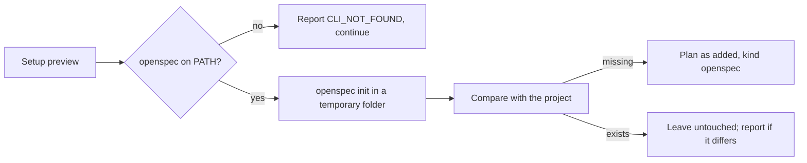

# OpenSpec project files during setup

[Source](cli_openspec.py). Makes setup add OpenSpec's own project files for the selected clients, so [`asdg-openspec-propose`](../../skills/asdg-openspec-propose/SKILL.md) finds the native skill it needs.
OpenSpec stays a separately installed tool: this module runs the `openspec` command already on the machine and never downloads it.



## Responsibilities and collaborators

| Responsibility | Collaborators |
| --- | --- |
| Produce OpenSpec's files without touching the project | `openspec init <tmp> --tools ... --no-animation --no-copilot-cloud`, stdin closed, 60 s limit |
| Plan only what is missing | [`cli_install`](cli_install.md) turns each addition into an ordinary planned write inside the approved plan |
| Report native skill presence without running anything | [`cli_project.inspect`](cli_project.md), shown by `verify` |
| Read files safely | [`cli_files`](cli_files.md): `safe_path`, `read_bytes`, `Conflict` |

## Interface

| Callable | Contract |
| --- | --- |
| `enabled()` | False when `ASDG_OPENSPEC` is `0`, `off`, `false` or `no`. |
| `presence(root, clients)` | `{client: PRESENT or MISSING}` for `.agents/skills/openspec-propose/SKILL.md` (Codex) and `.claude/skills/openspec-propose/SKILL.md` (Claude). |
| `generated(cli, clients)` | `{relative path: bytes}` written by OpenSpec in a disposable folder. A symlink or a path outside `openspec`, `.claude`, `.agents` raises `OSError`. |
| `plan_openspec(root, clients, skip=False)` | `(report, additions)`. Report: `state`, `clients`, `version`, `added`, `kept_differing`, `skills`, and `problem` on failure. |
| `note(report)` | One sentence for the setup notes, or `None`. |

States: `SKIPPED` (flag, environment or no client), `CLI_NOT_FOUND`, `FAILED`, `PLANNED` (something to add) and `PRESENT` (nothing to add).

## Effects and failure behavior

Add-only: an existing file is never planned, even when it differs from what this OpenSpec version writes; it is listed under `kept_differing`.
A missing command, a non-zero exit, a timeout, an unexpected output path or an unsafe target path yields a report and no additions. A third-party tool never blocks ASDG setup.
The command runs during preview too, in a temporary folder that is removed afterwards, with `DO_NOT_TRACK=1` and `OPENSPEC_TELEMETRY=0`. Whether OpenSpec honours those variables was not verified.
OpenSpec's output for one version was observed to be identical across runs, which keeps the plan token stable between preview and apply; a changed version changes the token and requires a fresh preview.

## Example

```python
report, additions = plan_openspec(root, ['claude'])
# report['state'] == 'PLANNED'; additions == [(Path('.claude/skills/openspec-propose/SKILL.md'), b'...'), ...]
```
