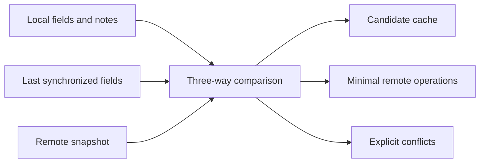

# Project plan reconciliation

The sync command uses this pure component to compare a planner's structured cache with one complete GitHub snapshot. It preserves local notes and identifies competing edits before any remote mutation.

| Component | Responsibility | Collaborators |
| --- | --- | --- |
| `validate_cache` | Reject malformed, duplicate or ambiguous local identities and fields; copy valid data | `cli_files.Conflict` |
| `empty_cache` | Create schema version 1 without inferring tasks from prose | Validator |
| `reconcile` | Merge each field against its last synchronized value; describe imports, writes and conflicts | Validated cache, normalized provider snapshot |

The three inputs determine a candidate; this component performs no file, process or network operations.

## Data and public entry points

`empty_cache(repo, owner=None, title=None, number=None)` returns `schema_version`, `repository`, `project` and `items`. Project identity contains owner, optional positive number and title.
`validate_cache(cache)` returns a deep copy or raises `Conflict`; exact local object keys prevent silently losing unrecognized content.
Each item contains stable `id`, optional `issue_number`, `fields`, `base`, local `notes` and local `sources`. New items have null base; bound items retain their last synchronized fields.
The seven shared string fields are title, body, state, status, priority, team and sprint. Title is nonempty; state is `OPEN` or `CLOSED`. Other vocabulary is the provider's concern.
Remote snapshots contain repository, optional project and all repository issues with stable ID, number, fields and optional Project item ID. Additional provider metadata is allowed.
`reconcile(cache, snapshot)` returns `cache`, `operations`, `conflicts` and imported IDs. Operations create/update issues, add Project membership or update changed Project fields; they never delete records.

## Safety and publication

A local-only edit exports; a remote-only edit imports; equal concurrent edits converge. Different edits to the same field conflict. No side wins merely because it is on `dev` or another branch.
Missing bound issues or projects and changed identities conflict. New marker collisions require identical issue fields before adoption; absent Project membership can then be completed.
Repository issues are imported, and missing Project membership is proposed for addition. Removing an item from the Project is not a supported exclusion mechanism.
Notes and sources are preserved only locally and never appear in operation fields. Issue state, Project status and sprint labels do not change ASDG implementation authorization.
The candidate is not a success receipt. The caller must block the whole apply when conflicts exist, then apply operations and verify a fresh remote snapshot before publishing the candidate baseline.
Newly created issues are bound only by the fresh readback. GitHub updates are not made atomic by this pure comparison.
Issue creation always requests `OPEN`; closing a newly created issue is a separate update. After a verified, journalled create, the caller may retain observed creation fields as a provisional baseline while preserving the user's desired fields, then finish remaining updates.

## Verification

[Merge tests](../../tests/test_plan_merge.md) exercise independent, disjoint, convergent and conflicting changes; creation/readback, imports, missing identities, ordering, schema errors and local-note preservation.
