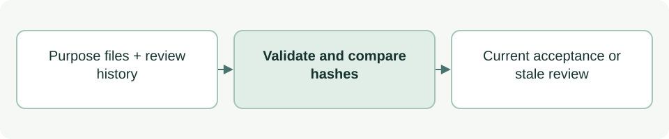

# Purpose review and acceptance

[Source: purpose_review.py](purpose_review.py)

Determines whether the current Purpose documents still match the version reviewed by the agent and accepted by the human.

## Responsibilities and collaborators

Validates the two review gates, hashes Purpose documents/navigation/images and reports acceptance freshness.

- [cli_files](cli_files.md): Reads bounded files and rejects unsafe paths.
- [cli_status](cli_status.md): Includes completion in the project snapshot.
- [test_purpose_review](../../tests/test_purpose_review.md): Exercises gates, migration history and image/link changes.

## Interface and data

Review events have decision, actor, recorded_at and artifacts:path→SHA256, plus criteria for readiness or statement for acceptance. CRITERIA names the seven checks of the Purpose definition itself; no implementation evidence or Stage 07 plan is required. LEGACY_CRITERIA keeps earlier eight-criterion readiness histories valid as input; validation cannot date an event, so the procedure, not this module, keeps new readiness on CRITERIA. The required statement is 01-purpose.md. Registered supplements, including the LEGACY_FLAT_DOCUMENTS and LEGACY_NESTED_DOCUMENTS of retired layouts, remain part of the exact reviewed bundle.

| Callable or interface | Contract |
| --- | --- |
| `validate_reviews(reviews: list) -> None` | Checks event schema, stage-local hashes, a complete current or legacy criteria set and a matching earlier readiness event for User acceptance. |
| `bundle_hashes(root: Path, files: list[str]) -> dict[str, str]` | Returns hashes for the statement, registered supplements, README and referenced images; validates local links and a required explanatory image. |
| `completion_status(root: Path, entry: dict) -> dict` | Returns status, agent_ready, user_accepted, review_stale and reason; compares the current bundle with the latest event. |

## Effects and failure behavior

Invalid history raises Conflict. Missing/changed current content yields stale IN_PROGRESS status. This module reads only; it neither records acceptance nor authenticates who made a statement.

## Example

`completion_status(root, entry)` evaluates a stage 02 lifecycle entry without altering its review history.
