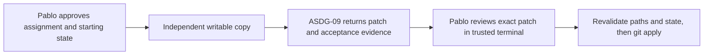

# Provider component ownership
Pablo assigns a named, bounded task to ASDG-09 in an independent disposable Git clone. Admin owns the policy, receipt operation and checks. Only Pablo applies the reviewed Git patch to the authoritative standalone checkout. Initialized clients use their ordinary sprint gate.

Use the [operator procedure](review.md). Keep the source checkout, assignment, baseline record, reviewed patch and trusted checker outside every implementation-session writable root. Start the implementation session in the clone with filesystem sandboxing, approvals disabled, and no alternate write-capable connectors. Changing directory alone cannot establish that boundary.
The assignment binds the physical source root, Git origin and revision, role, objective, component, exact files and acceptance criteria. Optional `inputs` name additional read-only files within that component when acceptance depends on pending changes. Preparation copies all assigned targets and inputs with their current contents and modes. The baseline records their hashes, absence and Git index entries. Other files in the clone come from HEAD.
[policy.py](policy.py) supplies the provider rule for the common evaluator and inspects Git patch endpoints in both directions. A scope or starting-state change requires a fresh preparation and human decision. The provider check is a review of proposed changes. A CLI declaration never grants write access.
