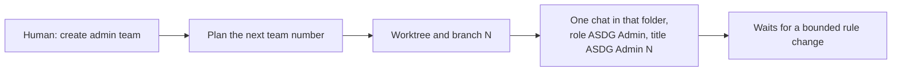

# ASDG create team admin

Give the user a separate place to change ASDG's own rules: one ASDG Admin chat working in its own Git worktree and branch, so rule changes stay apart from the project teams' work until the human merges them.
It is [Create team](../asdg-create-team/SKILL.md) with a different roster; that workflow and [numbered teams](../asdg-create-team/numbered-teams.md) stay authoritative for everything this page does not say.

*An admin team is one chat today; it shares the number sequence with project teams.*

## When to use

Use it only when the human explicitly invokes `$asdg-create-team-admin` or plainly asks for an admin team.
Never invoke it on your own initiative, from a recommendation, or to get past a restriction met during project work.
Read client instructions, [session policy](../asdg-focus/session-policy.md) and the [Admin entry](../../admin/AGENTS.md); preserve this chat's own role, subject and attitude.

## Create the team

1. Resolve the client root as `../../..` from this directory and verify the Admin sources that the [Admin entry](../../admin/AGENTS.md) lists under "Load on role invocation".
2. An admin team always takes a number and a worktree, even when it is the first admin team: follow [numbered teams](../asdg-create-team/numbered-teams.md) from "Create the worktree and branch", including the plan shown to the user and the offer about files not carried.
3. Start one fresh chat with the new worktree as its working folder, using the surface's native tools as [missing-chat creation](../asdg-create-team/create-chats.md) describes. Create no specialist chats.
4. Its initial prompt names the worktree as project root, quotes the human's request word for word with its date as the explicit Admin selection, asks the chat to follow [the Admin skill](../asdg-admin/SKILL.md), to confirm the role briefly and then to wait.
5. The prompt passes no maintenance scope unless the human gave one; a scope the human did give is quoted, never paraphrased into something wider.
6. Retain the returned chat ID. A started chat is not an activated role: confirm its first report shows ASDG Admin loaded, or report activation pending or failed.

## Title and receipt

The chat is titled `ASDG Admin <team number>`, as the [title contract](../asdg-focus/rename-chat.md#compose-the-title) says, and records the number, worktree and branch in its receipt.
The calling chat keeps its own title and role.

## Report

Say the team number, folder, branch, base revision, the files not carried, the chat's actual title and whether Admin activation was confirmed.
State plainly what the surface could not do; where it cannot start a chat in a chosen folder, keep the worktree and give the path to open by hand.

## Limits

Creating the team selects Admin for that one chat and authorizes no rule change, commit, push, merge or hook trust.
The Admin chat still needs a bounded scope from the human for every change, and its changes reach other teams only when the human merges its branch.
No admin team has been created by this workflow yet; the worktree steps were done by hand on 20 November 2026.
