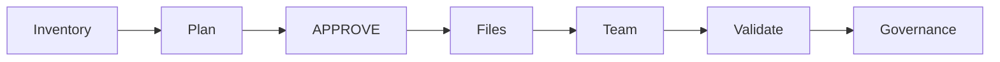

# Prepare the team during initialization

[Create team](SKILL.md) is the single team workflow for direct setup and [Init](../asdg-init/SKILL.md).
Init uses its discovery/reuse phase before approval and its creation/validation phase after file installation.

## Preview without side effects

Read the selected source catalogue, Focus choices and role sources before installation; do not require installed target adapters yet.
For Codex use the parent workflow's native project resolution and reuse criteria. Inventory must cover the verified target project, including pinned chats.
Retain every confirmed generic role's ID and activation receipt. A title is insufficient. Preserve separate subject/attitude sessions; ambiguous candidates or incomplete inventory block the init preview.
A fresh project with confirmed empty inventory has `roles: []`; do not infer emptiness from missing files.
Save a unique temporary JSON file outside the target with the [inventory schema](../../scripts/lib/cli_team.md). Pass it as `--team-inventory PATH` on both preview and apply.
Include that inventory and the resulting `team` effects beside the complete file report in the approval presentation: all roles, create/reuse IDs, project ID, initial activation prompts and capability limits.
For Claude use the parent workflow's client mode: installed adapters and role sources, Governance default, manual specialist Focus; no native chat creation is promised.
For both clients prepare both modes; lack of Codex tools blocks Codex team readiness.

## Apply the approved effects

A standalone APPROVE for this exact complete init plan authorizes its missing team chats and initial role activation; do not ask a second team-creation question.
Recheck native inventory immediately before file apply. If planned roles, project or IDs changed, stop for a fresh full preview and APPROVE.
After file apply and structural verification, load the installed canonical Create team workflow and confirm its prerequisites.
Reuse exactly the confirmed IDs. Create only approved missing roles using [missing-chat creation](create-chats.md); retain IDs immediately and wait for activation receipts.
Recheck inventory before each creation; on concurrent candidates, uncertain outcome or inconsistent receipts stop and preserve successful chats. Never silently replace, reset or duplicate chats.
An exact matching team is already satisfied. A partial team with confirmed receipts can safely add only missing roles; unresolved partial state needs explicit reconciliation.
Apply the parent workflow's ordering rules; shared sorting preference changes still need separate explicit approval and never block role availability.
Validate all thirteen project/role/subject/attitude receipts and installed structure. Report pending/failed activation as incomplete initialization, with exact remaining roles.
Native failure cannot roll back installed files or delete successful chats. Re-run discovery and a new complete plan to resume; never blindly replay creation.
Claude readiness means adapters and all role sources verified, with Governance's required sources successfully loaded in the target project chat; specialists are available through manual Focus.
Report file installation separately from team readiness. `installation_complete` is the engine's file result; `initialization_complete: false` means native/client completion has not been established by Python.
Do not fabricate a machine completion flag or persisted team state. Keep the final observed readiness receipt in the installation conversation.
After successful team validation, Governance is available as the default project role. Preserve explicit selections in existing chats, including the installer; Admin is never added to the team.
Run the installed Status workflow in the Governance context and report project facts and one recommended next action without executing that recommendation.
