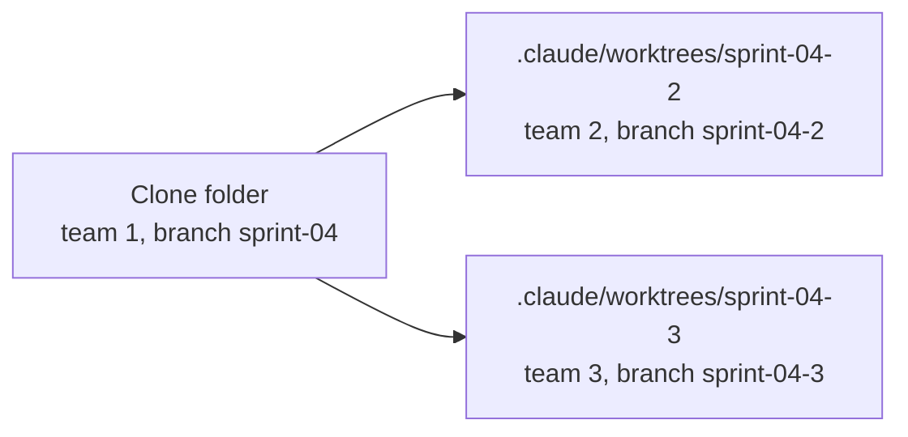

# Numbered teams: one worktree and one branch per team

Use only within [Create team](SKILL.md) or [Create team admin](../asdg-create-team-admin/SKILL.md).

A project has one clone folder. The first team works in it. Every later team gets a number, its own Git worktree inside the clone and its own branch, so teams do not overwrite each other's files.

*One clone, never a second one; each team's chats share that team's folder and branch.*

## Which team this request creates

1. No team in this project yet: create team 1 in the clone folder as [Create team](SKILL.md) describes. It has no number, no worktree and no new branch.
2. Team 1 exists and its roster is complete: create the next team. Do not reuse team 1's chats for it.
3. The last team's roster is incomplete: say which roles are missing and ask once whether to complete that team or to create the next one.

Both kinds of team, project and admin, share one sequence of numbers.

## Create the worktree and branch

1. From the calling chat's folder run the [team worktree script](team_worktree.md) without `--create` and read its plan. Pass `--seen N` for each team number found in a lead chat's title but not in the plan's teams.
2. Tell the user the number, branch, folder and base revision, and list the files under "not carried": uncommitted work in the calling folder that the new team will not have.
3. Run the script with `--create`. Stop on `BLOCKED` and report it; never create the worktree by another route.
4. Offer once to copy the not-carried files into the new folder. Copy only on the user's yes, compare the copies, and say that the files now exist in two places. Never move, stash, commit or discard them.

The request that creates the team authorizes this worktree and local branch. It authorizes no commit, push, branch deletion or worktree removal.

## Start the chats inside the team folder

Start every chat of the team with the team's worktree as its working folder, and name that folder as the project root in each initial prompt.
Do not start a chat in the clone and move it afterwards: on 20 November 2026 a chat moved that way kept showing its old branch in the Claude phone app.
Where the surface cannot start a chat in a chosen folder, say so, keep the created worktree, and give the user the folder path to open by hand.

## Number in titles and receipts

Each chat of team N records the team number, worktree path and branch with its project binding in its receipt.
The number appears in the title as the [title contract](../asdg-focus/rename-chat.md#compose-the-title) says, for example `Alice ASDG Team Lead 2` and `05 Architecture 2`. Team 1 keeps its titles.
Routing still verifies project folder, role and stable thread ID; a number in a title proves no membership.

## What stays the same

Each team has its own lead under 00 Governance, or under ASDG Admin for an admin team. A team number grants no role and no authority.
Sprint state is a file in each team's folder, so two teams can show different sprint state until their branches are merged; merging is the human's decision.
Creating a team starts no project work and no sprint. Worktree creation was done by hand on 20 November 2026; a full numbered team has not yet been observed on any surface.
